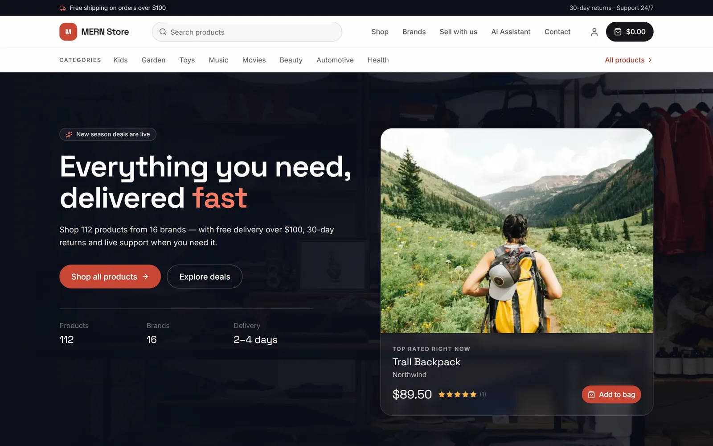
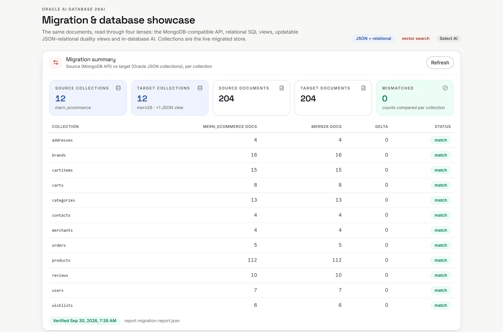
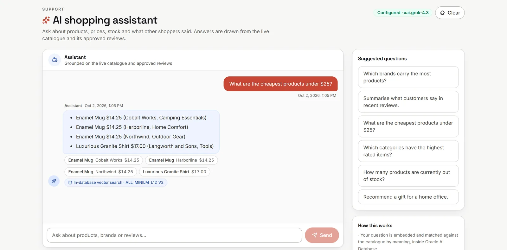
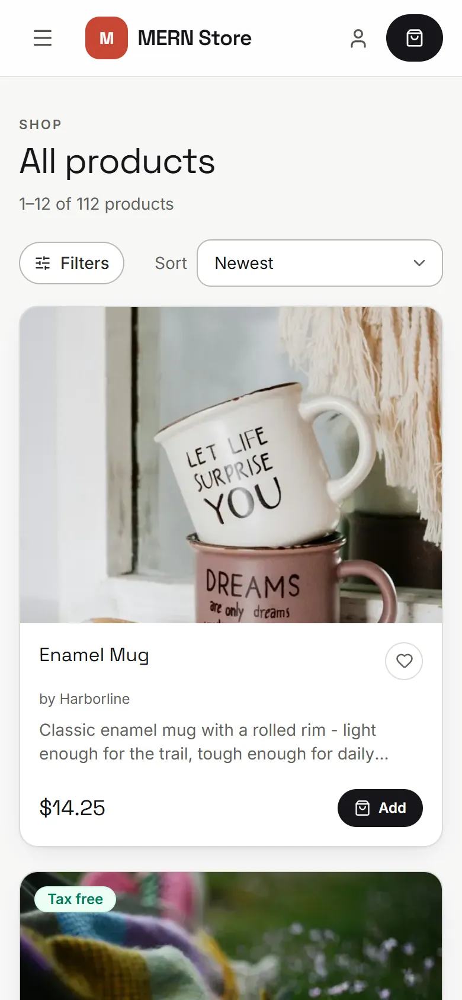
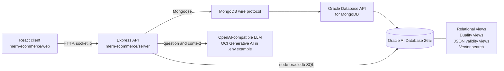

<div align="center">

# Migrate a MERN app from MongoDB to Oracle AI Database 26ai

### Moving a MongoDB app usually means rewriting its data layer. Here the driver, models and routes stay, and four query patterns changed.

[](LICENSE.txt)
[](https://www.oracle.com/database/)
[](mern-ecommerce/web/package.json)

[Quick start](#quick-start) · [See it work](#see-it-work) · [Migrate your own app](#migrate-your-own-app) · [Compatibility notes](#compatibility-notes) · [FAQ](#faq)



<sub>The storefront, served by the API running on Oracle AI Database 26ai through the MongoDB API.</sub>

</div>

---

## The problem

A MERN storefront (React 19, Express, Mongoose) is the example here: buyer, merchant and admin roles, catalogue, bag, checkout, orders, reviews, support chat, an AI assistant and a migration dashboard.

The mechanics are the familiar ones: `mongodump` the source, `mongorestore` into the target. What is new is the target. Oracle AI Database 26ai exposes the Oracle Database API for MongoDB (the "MongoDB API" below), which speaks the MongoDB wire protocol, so the Mongoose application keeps running against it. The migrated collections can then be read in place by SQL (relational views, and JSON schema "validity" views that report documents violating the inferred schema). JSON-relational duality views (one set of data exposed as updatable documents and as rows) are filled by an import and refreshed by re-running it. Vector search needs embeddings generated once from the catalogue.

---

## Quick start

> [!IMPORTANT]
> **What running this touches**
> - `npm run seed:db` writes demo data (an admin, 10 categories, 10 brands, 100 random products) into whatever `MONGO_URI` points at. Check it first.
> - The `sql/26ai` scripts use three accounts. `ADMIN` runs `01`, `02`, `03`, `03b` and `09b`: it creates the `MERN26` schema (JSON collections) and the `MERN26DV` schema (duality views), grants, ORDS enablement (Oracle REST Data Services, which serves the MongoDB API) and a network ACL. `MERN26` runs `04`, `05`, `07`, `08` and `09`: views, the vector store, and a Select AI credential and profile. `MERN26DV` runs `06`, `10` and the generated duality DDL.
>
> **What leaves the machine**
> - Each `/api/chat` request sends the LLM provider the question, up to the last six turns, retrieved product snippets, store-wide catalogue facts and excerpts of recent approved reviews. The route needs no sign-in and is rate limited. Embeddings and vector search stay in the database while `VECTOR_EMBEDDING_MODEL` is set.
> - Select AI (`POST /api/ai/ask`, admin) sends schema metadata and the question to its provider to get SQL back.
> - Mailgun and Mailchimp are contacted only when their keys are set.
>
> **How to undo**
>
> There is no teardown script. Stop the API first (it holds pooled `MERN26` sessions), then run the SQL below. Data seeded into a MongoDB for this demo is yours to clean up; the demo database is `mern_ecommerce` by default.

<details>
<summary><b>Undo SQL</b> (as <code>MERN26</code>, then as <code>ADMIN</code>)</summary>

```sql
-- As MERN26, if you ran 09: the Select AI profile and credential
begin
  dbms_cloud_ai.drop_profile(profile_name => 'MERN_LLM', force => true);
  dbms_cloud.drop_credential(credential_name => 'MERN_LLM_CRED');
end;
/

-- As ADMIN, if you ran 09b: the network ACL entry
begin
  dbms_network_acl_admin.remove_host_ace(
    host => 'inference.generativeai.<region>.oci.oraclecloud.com',  -- the region you gave 09b (default us-phoenix-1)
    ace  => xs$ace_type(privilege_list => xs$name_list('http'),
                        principal_name => 'MERN26', principal_type => xs_acl.ptype_db));
end;
/

-- As ADMIN: both schemas and everything they own (collections, views, vector table, ONNX model)
drop user mern26dv cascade;
drop user mern26 cascade;
```

</details>

Needs a MongoDB on `localhost:27017` as the source and Node.js 20.19+ or 22.12+ (the client's Vite 8 requirement; the API alone runs on Node 20). Use two terminals:

```bash
# Terminal 1: the API
git clone https://github.com/oracle-devrel/mongodb-migrate-oci.git
cd mongodb-migrate-oci/mern-ecommerce/server
npm install
cp .env.example .env      # set JWT_SECRET, e.g. the output of: openssl rand -hex 32
npm run seed:db admin@example.com "<password>"    # idempotent
npm start                 # API on http://localhost:3000
```

```bash
# Terminal 2, from the directory you cloned into: the client
cd mongodb-migrate-oci/mern-ecommerce/web
npm install
npm run dev               # http://localhost:8080, proxies /api and /socket.io to :3000
```

The API refuses to start without `JWT_SECRET` or with the placeholder, and warns under 32 characters. On plain MongoDB the storefront works; Oracle-only panels and endpoints report "not configured" until the Oracle settings are set.

**Oracle features** need an Autonomous AI Database 26ai with the MongoDB API enabled, MongoDB Database Tools, SQLcl 25.2+ for the scripts, and clients that support load-balanced connections ([guide 1.4](docs/26ai/migration-guide.md#14-review-supported-frameworks), [guide 2.1](docs/26ai/migration-guide.md#21-prerequisites)). In `.env` set `ORACLE_CONNECT_STRING`, `ORACLE_APP_USER` and `ORACLE_APP_PASSWORD` (no fallback to `ORACLE_USER`/`ORACLE_PASSWORD`; `ORACLE_DV_USER` defaults to `<app user>DV`), and the `LLM_*` settings for the assistant.

<details>
<summary><b>Alternative: Docker Compose</b> (web, API and a local MongoDB 7 container)</summary>

From `mern-ecommerce/`:

```bash
JWT_SECRET="$(openssl rand -hex 32)" ADMIN_PASSWORD="<password>" docker compose up --build
```

Open <http://localhost:8080>. The MongoDB container is the migration source and the seed is idempotent. This path was reviewed but not run for this README. Details in [`mern-ecommerce/README.md`](mern-ecommerce/README.md).

</details>

---

## See it work



<sub><b>Migration dashboard</b> (<code>/support/admin-db</code>). Source counts come from the saved <code>verify_migration.py</code> report; target counts are read from the database.</sub>



<sub><b>AI assistant</b> (<code>/support/llm-chat</code>). Retrieval runs inside Oracle; generation uses the configured model, here <code>xai.grok-4.3</code>. Each chip links to its product.</sub>

<details>
<summary><b>More screens</b></summary>



</details>

After the migration (steps below), check that every document arrived. `scripts/verify_migration.py` compares ids, counts and content hashes (numbers by exact decimal value). Exit codes: 0 PASS, 1 mismatch or nothing compared, 2 setup error (including a URI that does not name the database).

```bash
pip install -r scripts/requirements.txt
python scripts/verify_migration.py --source "<MongoDB URI with database>" --target "<Oracle MongoDB API URI with database>"
```

The dashboard's source counts come from `docs/26ai/migration-report.json` (or the path in `MIGRATION_REPORT`). `--report <path>` writes such a report; the script never writes to the dashboard's file by default, so copy only a PASS report there.

<details>
<summary><b>Output of the reference run</b> (12 collections, 204 documents, RESULT: PASS)</summary>

The reference dataset (112 products, 16 brands) is not in the repository; `npm run seed:db` creates a smaller random catalogue, so your counts and products will differ.

```
source: mern_ecommerce  (12 collections)
target: mern26  (12 collections, 1 views)  [views: PRODUCTS_ENRICHED]
------------------------------------------------------------------------------
[OK       ] addresses: source=4 target=4 missing=0 extra=0 differing=0
[OK       ] brands: source=16 target=16 missing=0 extra=0 differing=0
[OK       ] cartitems: source=15 target=15 missing=0 extra=0 differing=0
[OK       ] carts: source=8 target=8 missing=0 extra=0 differing=0
[OK       ] categories: source=13 target=13 missing=0 extra=0 differing=0
[OK       ] contacts: source=4 target=4 missing=0 extra=0 differing=0
[OK       ] merchants: source=4 target=4 missing=0 extra=0 differing=0
[OK       ] orders: source=5 target=5 missing=0 extra=0 differing=0
[OK       ] products: source=112 target=112 missing=0 extra=0 differing=0
[OK       ] reviews: source=10 target=10 missing=0 extra=0 differing=0
[OK       ] users: source=7 target=7 missing=0 extra=0 differing=0
[OK       ] wishlists: source=6 target=6 missing=0 extra=0 differing=0
------------------------------------------------------------------------------
RESULT: PASS - source and target documents match
```

</details>

---

## Migrate your own app

The `sql/26ai` scripts and `assess_workload.js` are written for this app's collections and schema names (`MERN26`, `MERN26DV`); adapt them before using them on another app.

1. **Plan.** Profile the source and check every operator the app uses against Oracle's support matrix (`assess_workload.js`).
2. **Prepare.** As `ADMIN`, run `sql/26ai/01_schemas.sql`: it creates the schemas and enables the MongoDB API for them.
3. **Execute.** `mongodump` the source, `mongorestore` into the target schema, grant the collections to `MERN26DV` (`03`), then point `MONGO_URI` at the target.
4. **Validate.** With no writers running: `scripts/verify_migration.py` and `sql/26ai/02_verify_counts.sql`.
5. **Extend.** Relational views (`04`), duality views (`05`, `06`, `10`), validity views (`03b`, `07`), vector store (`08`) and Select AI (`09b`, `09`).

<details>
<summary><b>Details of each step</b></summary>

**Plan.** Profile the source (`db.serverStatus()`, then profiling level 2 during a read-only pass), then report against the support matrix. The pipelines are in `mern-ecommerce/server/utils/queries.js`.

```bash
ASSESS_MODE=status mongosh "$MONGO_URI" --file mern-ecommerce/server/scripts/assess_workload.js
ASSESS_MODE=start  mongosh "$MONGO_URI" --file mern-ecommerce/server/scripts/assess_workload.js
# drive a read-only pass through the app, then:
ASSESS_MODE=report mongosh "$MONGO_URI" --file mern-ecommerce/server/scripts/assess_workload.js
```

**Prepare.** In Database Actions this is the *REST, GraphQL, MongoDB API, and Web access* toggle; the script runs `ORDS.ENABLE_SCHEMA` plus grants. Define the passwords first (`define mern26_password`, `define mern26dv_password`, or `accept ... hide`); the script stops if either is empty.

**Execute.** The restore URI is the target schema's MongoDB API URL (quote it; write `$external` as `%24external`):

```bash
mongodump --uri "mongodb://127.0.0.1:27017/mern_ecommerce" --out dump
mongorestore --drop --writeConcern '{w:1}' \
  --uri "mongodb://MERN26:<password>@<adb-host>:27017/mern26?loadBalanced=true&retryWrites=false&authMechanism=PLAIN&authSource=%24external&tls=true" \
  dump/mern_ecommerce
```

The positional directory must match the URI. A URI that names a database (as this one does) wants the database directory (`dump/mern_ecommerce`); the dump root restores 0 documents and still exits 0 ([guide 3.2](docs/26ai/migration-guide.md#32-restore-into-autonomous-through-the-mongodb-api)). After the first restore, `ADMIN` runs `03` (grants the collections to `MERN26DV`). `--drop` invalidates everything built on the collections, so a repeat restore needs the [guide 3.3](docs/26ai/migration-guide.md#33-re-create-what-depends-on-the-collections) rebuild: `03` and `03b` as `ADMIN`; `04`, `07` and `08` as `MERN26`; `06` and `10` as `MERN26DV`. Then point `MONGO_URI` at the target and apply the [compatibility notes](#compatibility-notes). To check the version:

```sql
select banner from v$version;
-- Oracle AI Database 26ai Enterprise Edition Release 23.26.3.3.0 - Production
```

**Validate.** `verify_migration.py` needs both `--source` and `--target`; `02_verify_counts.sql` is the SQL-side count check and hard-codes this app's 12 collections.

**Extend**, by account, in this order:

| Step | Account | Script |
|---|---|---|
| Relational views | `MERN26` | `04` |
| Duality views | `MERN26` | `05` generates the DDL into the `dv_generated_ddl` table; the reference output is in `sql/26ai/generated/duality_ddl/` |
| | `MERN26DV` | run the reviewed DDL (12 views), then `06` imports the documents and `10` publishes the view list to `MERN26` |
| Validity views | `ADMIN` | `03b` grants the duality views back to `MERN26` |
| | `MERN26` | `07` infers JSON schemas from the duality views and adds the validity views |
| Vector store | `ADMIN` | grant `execute on dbms_vector` and `create mining model` to `MERN26` |
| | `MERN26` | `load_onnx_embedding.py MERN26 "<password>" "<dsn>"` in the onnx2oracle venv loads the ONNX model; then `08` |
| | app | `VECTOR_EMBEDDING_MODEL=ALL_MINILM_L12_V2 node scripts/embed_catalog.js` from `mern-ecommerce/server` |
| Select AI | `ADMIN` | `09b` (one-time network ACL) |
| | `MERN26` | `09`, re-runnable; reads its key from the gitignored `09_select_ai_key.sql` (copy `09_select_ai_key.sql.example`) |

Duality views are a point-in-time copy: documents written through the MongoDB API after `06` appear only after `06` runs again. Reference run: 12 collections, 204 documents, 12 duality views, 132 documents in the validity views (users, products, orders, carts), all valid.

</details>

Full guide with results: [`docs/26ai/migration-guide.md`](docs/26ai/migration-guide.md). Presenter script with timings, reset and fallbacks: [`docs/26ai/demo-runbook.md`](docs/26ai/demo-runbook.md).

---

## Compatibility notes

Running the same app on both backends needed four code changes and one tooling difference:

| Pattern | What the Oracle API does | What the app does |
|---|---|---|
| `$lookup` | No `let`; an error if `localField` is an array, is missing from any input document or occurs more than once in one | `GET /api/product/list` replaces its `$lookup` joins (brands, approved reviews, the wishlist flag) with one `$sql` stage on Oracle (`server/utils/queries.js`). `loadBalanced=true` in `MONGO_URI` selects that branch |
| `$elemMatch` in an update filter | Rejected (`Invalid query opcode:$elemMatch`); reads accept it | Order-line updates address the array element by index with a conditional filter (`server/utils/store.js`, `setLineStatus`) |
| `$regex` with a separate `$options` | `$options` is ignored, so search was case-sensitive | The flags live on the RegExp: `new RegExp(term, 'i')` |
| Numeric limits | `skip` must fit in int32; `NUMBER` tops out near 1e126 | The API clamps paging and numeric filters so both backends answer the same |
| `profiler` command (tooling) | Not available | Profile on the source; use SQL Monitor on the target |

---

## How it works



Mongoose reaches the data through the MongoDB API. The showcase endpoints (migration dashboard, validity report, vector search) use node-oracledb for SQL against the same schemas. Select AI is the one path where the database itself calls the LLM (`MERN_LLM` profile, through the `09b` network ACL).

<details>
<summary><b>Duality and validity views</b></summary>

The documents in `MERN26` are JSON collections. `sql/26ai/04` adds relational views over them and `07` adds JSON schema validity views for users, products, orders and carts; both read the collections in place. `05` generates the DDL for 12 duality views in `MERN26DV`, the reviewed DDL creates them and `06` imports the documents. The views are updatable and expose the data as documents and as rows, as of the last import. Generated DDL is in `sql/26ai/generated/duality_ddl/`.

</details>

<details>
<summary><b>AI layer</b></summary>

all-MiniLM-L12-v2 is loaded into the schema as an ONNX model with [onnx2oracle](https://github.com/jasperan/onnx2oracle) (`mern-ecommerce/server/scripts/load_onnx_embedding.py`). `POST /api/ai/similar` and the retrieval half of `/api/chat` run inside Oracle with `VECTOR_DISTANCE`, once `scripts/embed_catalog.js` has stored the embeddings. The chat adds SQL catalogue facts and price filters (hybrid retrieval), keeps the last turns and returns its source products. Generation uses an OpenAI-compatible endpoint: OCI Generative AI in `.env.example` (`LLM_PROVIDER=oci`, model `xai.grok-4.3`), or any other endpoint through `LLM_BASE_URL` and `LLM_API_KEY`. `POST /api/ai/ask` (admin) exposes Select AI (natural language to SQL, read-only guard) when `SELECT_AI_PROFILE` is configured.

</details>

---

## Reference

### Documentation

| Document | Contents |
|---|---|
| [`docs/26ai/migration-guide.md`](docs/26ai/migration-guide.md) | Plan, Prepare, Execute, Validate, Extend, with the reference results |
| [`docs/26ai/demo-runbook.md`](docs/26ai/demo-runbook.md) | Presenter script in deck order, timings, reset, fallbacks |
| [`docs/26ai/api-contract.md`](docs/26ai/api-contract.md) | Every endpoint, payload, auth rule and error |
| [`docs/26ai/ui-inventory.md`](docs/26ai/ui-inventory.md) | Every screen |
| [`mern-ecommerce/README.md`](mern-ecommerce/README.md) | The app: environment, Docker, scripts |
| [Simple migration](solutions/simple-migration/README.md), [complex migration](solutions/complex-migration/README.md), [AI and analytics](solutions/ai-analytics/README.md) | Solution narratives |
| [`livelabs/`](livelabs/) | LiveLabs workshop content |

<details>
<summary><b>Repository layout</b></summary>

| Path | What it is |
|---|---|
| `mern-ecommerce/server` | Express and Mongoose API (MongoDB API for Oracle, SQL showcase endpoints, AI) |
| `mern-ecommerce/web` | React 19, Vite, Tailwind client |
| `sql/26ai` | Migration setup, validation, view, duality and AI scripts |
| `sql/23ai` | Previous release scripts, kept for reference |
| `scripts/verify_migration.py` | Document-level source to target verification |
| `docs/` | Guides, runbook, API contract, sample documents |
| `solutions/` | Simple migration, complex migration, AI and analytics narratives |
| `livelabs/` | LiveLabs workshop content |

</details>

<details>
<summary><b>Configuration summary</b> (full list with comments in <code>mern-ecommerce/server/.env.example</code>)</summary>

| Variable | Meaning |
|---|---|
| `JWT_SECRET` | Required; the API refuses to start without it or with the placeholder, and warns under 32 characters |
| `MONGO_URI` | Local MongoDB (source) or the Oracle MongoDB API URL (target) |
| `CLIENT_URL`, `CORS_ORIGINS`, `TRUST_PROXY` | Storefront URL, allowed browser origins, number of reverse proxies |
| `ORACLE_CONNECT_STRING` | Full descriptor or EZConnect `tcps://` string for node-oracledb |
| `ORACLE_APP_USER`, `ORACLE_APP_PASSWORD` | Schema owning the JSON collections (`MERN26`) |
| `ORACLE_DV_USER` | Schema owning the duality views (`MERN26DV`); defaults to `<app user>DV` |
| `LLM_PROVIDER`, `OCI_GENAI_ENDPOINT`, `OCI_GENAI_API_KEY`, `LLM_MODEL` | OCI Generative AI settings |
| `LLM_BASE_URL`, `LLM_API_KEY` | Any OpenAI-compatible endpoint; overrides the OCI settings |
| `VECTOR_EMBEDDING_MODEL`, `EMBEDDING_DIM`, `VECTOR_TABLE` | In-database embeddings (384 dimensions) |
| `SELECT_AI_PROFILE` | Select AI profile created by `sql/26ai/09_select_ai.sql` (`MERN_LLM`) |
| `MIGRATION_REPORT` | Path of the report the dashboard reads (written by `verify_migration.py --report`) |
| `MAILGUN_*`, `MAILCHIMP_*` | Optional; without them password reset and newsletter answer 503 |

</details>

### Data model

[`docs/mern_collection_examples.json`](docs/mern_collection_examples.json) has one sample document per collection. The schemas are the Mongoose models in `mern-ecommerce/server/models/`; the Oracle side is in `sql/26ai/generated/duality_ddl/`.

---

## FAQ

**Do I have to change application code?**
Some. The driver, models and routes stay; four query patterns changed, listed in [Compatibility notes](#compatibility-notes).

**Does data leave the database for the AI features?**
Yes. The chat sends the question, recent turns and catalogue context to the LLM provider, and Select AI sends schema metadata and the question. Details under [What leaves the machine](#quick-start).

**Why do my counts and products differ from the screenshots?**
The reference dataset is not in the repository. `npm run seed:db` creates a random catalogue of 100 products.

---

## Contributing

This project welcomes contributions from the community. Before submitting a pull
request, please [review our contribution guide](./CONTRIBUTING.md).

## Security

Please consult the [security guide](./SECURITY.md) for our responsible security
vulnerability disclosure process.

## License
Copyright (c) 2024, 2026 Oracle and/or its affiliates.

Licensed under the Universal Permissive License (UPL), Version 1.0.

See [LICENSE](LICENSE.txt) for more details.

ORACLE AND ITS AFFILIATES DO NOT PROVIDE ANY WARRANTY WHATSOEVER, EXPRESS OR IMPLIED, FOR ANY SOFTWARE, MATERIAL OR CONTENT OF ANY KIND CONTAINED OR PRODUCED WITHIN THIS REPOSITORY, AND IN PARTICULAR SPECIFICALLY DISCLAIM ANY AND ALL IMPLIED WARRANTIES OF TITLE, NON-INFRINGEMENT, MERCHANTABILITY, AND FITNESS FOR A PARTICULAR PURPOSE.  FURTHERMORE, ORACLE AND ITS AFFILIATES DO NOT REPRESENT THAT ANY CUSTOMARY SECURITY REVIEW HAS BEEN PERFORMED WITH RESPECT TO ANY SOFTWARE, MATERIAL OR CONTENT CONTAINED OR PRODUCED WITHIN THIS REPOSITORY. IN ADDITION, AND WITHOUT LIMITING THE FOREGOING, THIRD PARTIES MAY HAVE POSTED SOFTWARE, MATERIAL OR CONTENT TO THIS REPOSITORY WITHOUT ANY REVIEW. USE AT YOUR OWN RISK.
