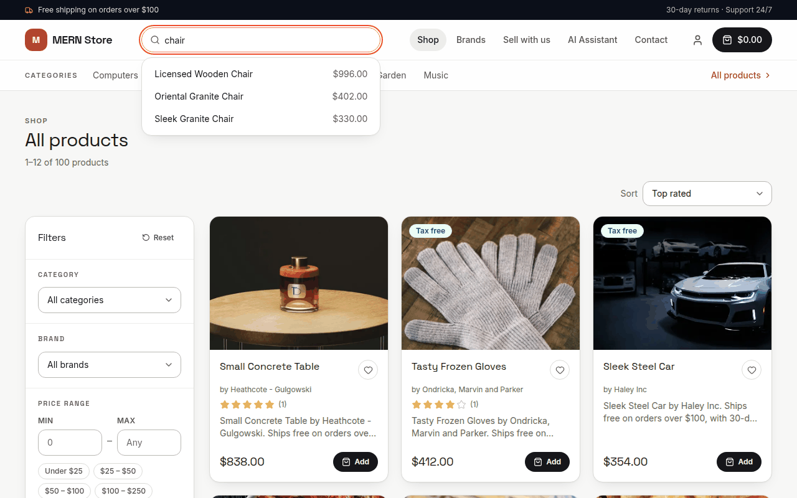
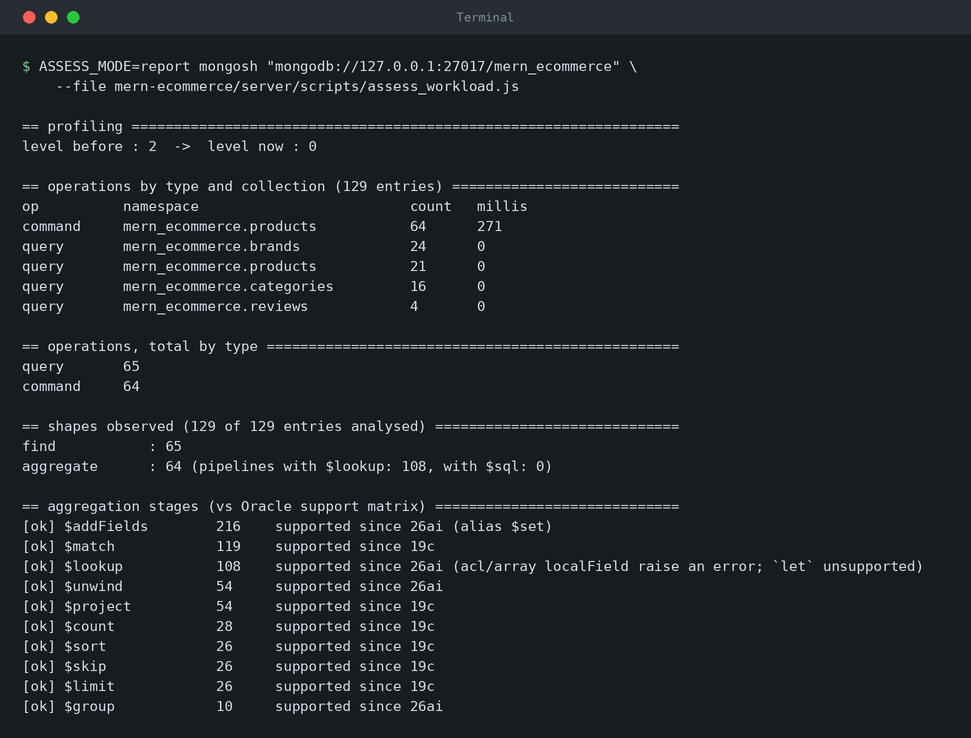
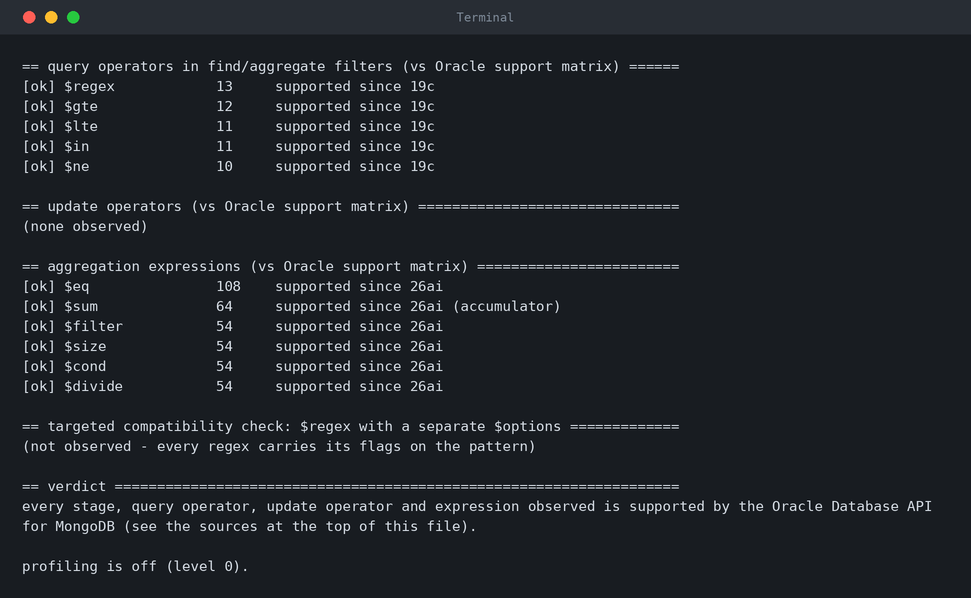

# Assess the MongoDB Workload

## Introduction

Oracle's migration process has four stages: **plan, prepare, execute, validate**. This lab is the **plan** stage. Before you move any data, you find out what the storefront actually sends to MongoDB and check every operator against the support matrix of the Oracle Database API for MongoDB. That check tells you which parts of the application need attention, instead of letting you discover them in production.

You use `assess_workload.js`, a dependency-free `mongosh` script in the repository. It runs against the source MongoDB only; nothing in this lab touches Autonomous AI Database.

Estimated Time: 20 minutes

### Objectives

In this lab, you will:

* Record the size of the source database (the numbers you compare with after the migration)
* Profile a real browsing session with the MongoDB profiler
* Read the compatibility report and understand the four code patterns the storefront had to change

### Prerequisites

This lab assumes you have:

* Completed **Lab 3: Run the Storefront on MongoDB**, with the MongoDB container, the API (`npm start`) and the client (`npm run dev`) still running
* A new terminal open at the **root of the cloned repository**

## Task 1: Capture the source status

Record what the source contains now, so you can prove later that nothing was lost. The `status` mode prints `db.serverStatus()` (version, uptime, connections, operation counters) and the document count of every collection.

1. Run the assessment in `status` mode.

    <if type="linux">

    ```bash
    <copy>
    ASSESS_MODE=status mongosh "mongodb://127.0.0.1:27017/mern_ecommerce" \
      --file mern-ecommerce/server/scripts/assess_workload.js
    </copy>
    ```

    </if>

    <if type="windows">

    ```powershell
    <copy>
    $env:ASSESS_MODE = "status"
    mongosh "mongodb://127.0.0.1:27017/mern_ecommerce" --file mern-ecommerce/server/scripts/assess_workload.js
    </copy>
    ```

    </if>

2. Find the **collections** table and its `TOTAL` line, and write the numbers down. You compare them with the target in Labs 6 and 7.

    For the seeded storefront, the output looks like this. The server numbers in the first part differ on your machine. The collection counts are the ones to write down.

    ```text
    == db.serverStatus() - mern_ecommerce ========================================
    version            : 7.0.45
    host / process     : 7b5c40076ed7 / mongod
    uptime             : 19 s
    connections        : current 4, available 405, totalCreated 19
    storageEngine      : wiredTiger
    opcounters         : {insert=133, query=126, update=100, delete=0, getmore=0, command=70}
    opcountersRepl     : {insert=0, query=0, update=0, delete=0, getmore=0, command=0}
    network bytes      : in 110298, out 46098, requests 425
    mem resident       : 151 MB

    == collections in mern_ecommerce =============================================
    addresses             1
    brands                10
    cartitems             4
    carts                 1
    categories            10
    contacts              1
    merchants             1
    orders                1
    products              100
    reviews               2
    users                 1
    wishlists             1
    TOTAL                 133  (12 collections)

    == profiler ==================================================================
    profiling level    : 0 (slowms 100)

    next: ASSESS_MODE=start ... --file scripts/assess_workload.js
    ```

    You should see 12 collections and a `TOTAL` of 133 documents for the seeded storefront with the sample activity from Lab 3 (100 products, 10 brands, 10 categories and 13 documents in the other nine collections).

## Task 2: Start the profiler and generate traffic

The MongoDB profiler records every operation the database receives. Profiling shows what the application really runs, which is more reliable than reading the code. The `start` mode drops any earlier `system.profile` collection (where the profiler stores its records) and then calls `db.setProfilingLevel(2)`, so every operation is recorded.

1. Start profiling.

    <if type="linux">

    ```bash
    <copy>
    ASSESS_MODE=start mongosh "mongodb://127.0.0.1:27017/mern_ecommerce" \
      --file mern-ecommerce/server/scripts/assess_workload.js
    </copy>
    ```

    </if>

    <if type="windows">

    ```powershell
    <copy>
    $env:ASSESS_MODE = "start"
    mongosh "mongodb://127.0.0.1:27017/mern_ecommerce" --file mern-ecommerce/server/scripts/assess_workload.js
    </copy>
    ```

    </if>

    You should see `profiling level now` set to `2`:

    ```text
    profiling level before : 0
    dropped the previous system.profile
    system.profile exists  : true
    profiling level now    : 2 (slowms 100)

    Profiling every operation. Browse the storefront read-only now (Shop, filters, search,
    product pages), then summarise (and switch profiling off) with ASSESS_MODE=report.
    ```

2. Open the storefront at `http://localhost:8080` and use it the way a shopper would:

    * Open the home page and **Shop**
    * Change the sort order and page
    * Filter by a category and by a brand
    * Type a word from a product name into the search box
    * Open a few product pages

    The Shop page has the sort order and the filters. The search box lists the products whose name matches while you type. The products are random, so search for a word from your own catalogue. The screenshot searches for `chair`.

    

    > **Note:** Keep this session **read-only**. Do not place orders or register users while profiling, so the report shows the read paths.

## Task 3: Report and read the findings

The `report` mode summarizes what the profiler recorded and judges each operator against the support matrix. It switches profiling **off first**, so a run can never leave profiling enabled.

1. Print the report.

    <if type="linux">

    ```bash
    <copy>
    ASSESS_MODE=report mongosh "mongodb://127.0.0.1:27017/mern_ecommerce" \
      --file mern-ecommerce/server/scripts/assess_workload.js
    </copy>
    ```

    </if>

    <if type="windows">

    ```powershell
    <copy>
    $env:ASSESS_MODE = "report"
    mongosh "mongodb://127.0.0.1:27017/mern_ecommerce" --file mern-ecommerce/server/scripts/assess_workload.js
    </copy>
    ```

    </if>

2. Read the report. It is long, so it is shown here in two parts, from a run with the traffic of Task 2. The first part shows what the application ran: the operations by collection, the shapes and the aggregation stages.

    

    The second part shows the query operators, the update operators, the expressions, the targeted `$regex` check and the verdict.

    

    These are the sections of the report:

    | Section | What it tells you |
    | --- | --- |
    | **operations by type and collection** | What the application ran against which collection |
    | **shapes observed** | The number of `find` and `aggregate` operations, and how many pipelines use `$lookup` |
    | **aggregation stages**, **query operators**, **expressions** | One line per construct, marked `[ok]` with the first Oracle release that supports it (for example `$match` since 19c, `$lookup` since 26ai), or `[!!]` if it is not supported |
    | **targeted compatibility check: `$regex` with a separate `$options`** | Any `{$regex: ..., $options: ...}` filter, which the Oracle Database API for MongoDB handles differently (see Task 5) |
    | **verdict** | Whether every construct observed is supported |

    In this run the profiler recorded 129 operations: 65 `find` and 64 `aggregate`. Find the `$lookup` line in the first part. It is marked `[ok]`, but its note lists the restrictions: an array value in `localField` raises an error, and `let` is unsupported. `$lookup` is the one construct with real restrictions on Oracle, and Task 5 shows what the storefront does about it. Your counts differ with your browsing, but the pattern is the same.

3. Drop the profile collection. Profiling is already off, and the source database should not keep this artifact. If you leave it, the verification script in Lab 7 reports it as a skipped system collection.

    ```bash
    <copy>
    mongosh "mongodb://127.0.0.1:27017/mern_ecommerce" --quiet --eval "db.getCollection('system.profile').drop()"
    </copy>
    ```

## Task 4: Review the supported client versions

The Oracle Database API for MongoDB requires clients that support **load-balanced connections** (a connection option, `loadBalanced=true`, that you use in every connection string from Lab 6 on). These are the minimum versions from the migration guide.

| Client | Minimum version |
| --- | --- |
| mongosh | 0.15.6 |
| Database Tools (`mongodump`, `mongorestore`) | 100.5.0 |
| Node.js driver (through Mongoose 6.10.0) | 4.1.0 |
| PyMongo (`scripts/verify_migration.py`) | 3.12.0 |
| Compass | 1.28.1 |

1. Check the versions on your workstation.

    ```bash
    <copy>
    mongosh --version
    mongodump --version
    </copy>
    ```

    You should see versions at or above the minimums in the table. For example:

    ```text
    2.13.0
    mongodump version: 100.19.1
    ...
    ```

## Task 5: Understand the code changes the assessment justifies

The assessment matters because each difference between the two backends returns a wrong or empty answer, not always a loud error. Running the same storefront on both backends needed four code changes and one tooling difference:

| Pattern | What the Oracle Database API for MongoDB does | What the storefront does |
| --- | --- | --- |
| `$lookup` | No `let`; an error if `localField` is an array, is missing from any input document, or occurs more than once in one | `GET /api/product/list` joins brands, approved reviews and the wishlist flag with **one `$sql` stage** on Oracle (`server/utils/queries.js`). `loadBalanced=true` in `MONGO_URI` selects that branch |
| `$elemMatch` in an update filter | Rejected (`Invalid query opcode:$elemMatch`); reads accept it | Order-line updates address the array element by index with a conditional filter (`setLineStatus` in `server/utils/store.js`) |
| `$regex` with a separate `$options` | `$options` is ignored, so search becomes case-sensitive | The flags live on the pattern: `new RegExp(term, 'i')` (`server/routes/api/product.js`) |
| Numeric limits | `skip` must fit in int32; `NUMBER` tops out near 1e126 | The API clamps paging and numeric filters so both backends answer the same |
| `profiler` command (tooling) | Not available | Profile the source; use SQL Monitor on the target |

The excerpts below are copied from the repository. A line with `...` stands for lines left out between statements. Where code was replaced, **Before** is the old code, taken from the repository history, and **After** is the code in the repository today. You do not need to run anything in this task.

1. **`$lookup` becomes one `$sql` stage.** The product list joins every product to its brand, to its approved reviews and, for a signed-in shopper, to the wishlist. `server/utils/queries.js` holds both versions and picks one when the API starts. The connection string decides: a `MONGO_URI` that contains `loadBalanced` is the Oracle endpoint.

    ```javascript
    const ORACLE_API = /loadBalanced/i.test(process.env.MONGO_URI || '');
    ...
      const pipeline = [
        { $match: match },
        ...(ORACLE_API ? [oracleJoinStage(userId)] : mongoJoinStages(userId)),
        // Products of an inactive (or missing) brand are not for sale.
        { $match: { 'brand.isActive': true } }
      ];
    ```

    On MongoDB, `mongoJoinStages` joins with `$lookup` stages: one for the brands, one for the reviews and, for a signed-in shopper, one for the wishlists. The wishlist `$lookup` uses `let`, which the Oracle API does not support.

    ```javascript
    const mongoJoinStages = userId => {
      const stages = [
        {
          $lookup: {
            from: 'brands',
            localField: 'brand',
            foreignField: '_id',
            as: 'brands'
          }
        },
        ...
        {
          $lookup: {
            from: 'reviews',
            localField: '_id',
            foreignField: 'product',
            as: 'reviews'
          }
        },
        ...
      ];

      if (userId) {
        stages.push(
          {
            $lookup: {
              from: 'wishlists',
              let: { product: '$_id' },
              pipeline: [
                {
                  $match: {
                    $and: [
                      { $expr: { $eq: ['$$product', '$product'] } },
                      { user: new Mongoose.Types.ObjectId(userId) }
                    ]
                  }
                }
              ],
              as: 'isLiked'
            }
          },
          ...
        );
      }
      ...
    };
    ```

    On Oracle, `oracleJoinStage` makes the same joins in one `$sql` stage. In the SQL, the table `input` holds the documents of the preceding stage: here, the products that passed the first `$match`.

    ```javascript
    const oracleJoinStage = userId => {
      const wishlist = userId
        ? `,
        'isLiked' value nvl(
          (select json_value(w.data, '$.isLiked' returning boolean)
             from wishlists w
            where w.data.product.idOnly() = i.data."_id".idOnly()
              and w.data."user".idOnly() = hextoraw('${new Mongoose.Types.ObjectId(userId).toString()}')
            fetch first 1 row only), false)`
        : '';

      return {
        $sql: `select json_mergepatch(i.data, json_object(
        'brand' value json_object('_id' value b.data."_id", 'name' value b.data.name, 'isActive' value b.data.isActive returning json),
        'totalRatings' value nvl(rv.total, 0),
        'totalReviews' value nvl(rv.cnt, 0),
        'averageRating' value case when nvl(rv.cnt, 0) = 0 then 0 else rv.total / rv.cnt end${wishlist}
        returning json) returning json)
      from input i
      left outer join brands b on i.data.brand.idOnly() = b.data."_id".idOnly()
      left outer join (select r.data.product.idOnly() pid, count(*) cnt, sum(r.data.rating.number()) total
                         from reviews r
                        where r.data.status.string() = '${REVIEW_STATUS.Approved}'
                        group by r.data.product.idOnly()) rv
        on i.data."_id".idOnly() = rv.pid`
      };
    };
    ```

    * `left outer join brands b` is the brand `$lookup`.
    * The subquery `rv` counts and sums the approved reviews, one row per product. It takes the place of the review `$lookup` and of the `$filter`, `$sum`, `$size` and `$cond` expressions.
    * The `isLiked` subquery is the wishlist flag. It is added only when a shopper is signed in, and it takes the place of the `$lookup` with `let`.

    Both branches add the same fields to every product. This is one product from `GET /api/product/list` on the source, shortened to the fields the joins add. The Shop page from Task 2 shows the same data: the brand under the product name, the stars with the number of reviews, and the **Top rated** sort, which orders by `averageRating`.

    ```json
    {
      "_id": "6adb62e4f6c51f854352880c",
      "name": "Small Concrete Table",
      "price": 838,
      "brand": { "name": "Heathcote - Gulgowski", "_id": "6adb62e4f6c51f8543528801", "isActive": true },
      "totalRatings": 5,
      "totalReviews": 1,
      "averageRating": 5
    }
    ```

    This is the key to the cut-over in Lab 7: the connection string is both the endpoint and the feature flag. Nothing else in the application changes.

2. **`$elemMatch` in an update filter becomes an index-addressed update.** An order is a cart, and the order lines are the elements of its `products` array. Cancelling or updating one line is a conditional update of one element: set the status, unless the line is already `Cancelled`. In MongoDB that filter is usually written with `$elemMatch`. The Oracle API rejects `$elemMatch` in an update filter (`Invalid query opcode:$elemMatch`), although it accepts it in a read. The repository history has no `$elemMatch` update filter, so this **Before** is the usual MongoDB form, written from the migration notes:

    ```javascript
    await Cart.updateOne(
      {
        _id: cart._id,
        products: { $elemMatch: { _id: line._id, status: { $ne: CART_ITEM_STATUS.Cancelled } } }
      },
      { $set: { 'products.$.status': status } }
    );
    ```

    **After**, `setLineStatus` in `server/utils/store.js` finds the index of the line and puts it in the path (`products.0`, `products.1`, and so on):

    ```javascript
    exports.setLineStatus = async (cart, line, status) => {
      const index = cart.products.findIndex(item => String(item._id) === String(line._id));
      if (index === -1) return false;

      const path = `products.${index}`;
      const result = await Cart.updateOne(
        {
          _id: cart._id,
          [`${path}._id`]: line._id,
          [`${path}.status`]: { $ne: CART_ITEM_STATUS.Cancelled }
        },
        { $set: { [`${path}.status`]: status } }
      );

      return result.modifiedCount === 1;
    };
    ```

    The filter checks the `_id` of the line at that index, so a stale index never changes another line. The `$ne` condition makes a second cancel do nothing, so the stock is given back only once.

3. **`$regex` with a separate `$options` becomes a RegExp that carries its flags.** The storefront search box calls `GET /api/product/list/search/:name`. **Before**, the case-insensitive flag travelled in a separate `$options` field (`server/routes/api/product.js`, from the repository history):

    ```javascript
    const productDoc = await Product.find(
      { name: { $regex: new RegExp(name), $options: 'is' }, isActive: true },
      { name: 1, slug: 1, imageUrl: 1, price: 1, _id: 0 }
    );
    ```

    **After**, the flags are on the pattern (`server/routes/api/product.js`):

    ```javascript
    const products = await Product.find(
      { name: { $regex: new RegExp(escapeRegex(name), 'i') }, isActive: true },
      { name: 1, slug: 1, imageUrl: 1, price: 1, _id: 0 }
    )
      .sort({ name: 1, _id: 1 })
      .limit(20);
    ```

    `escapeRegex` (`server/utils/utils.js`) turns the typed text into a literal pattern, so a `(` or a `*` in the search box cannot break the RegExp:

    ```javascript
    // Turns a user-typed search term into a literal pattern. Search boxes feed the
    // value straight into a RegExp, so an unbalanced ( or * would otherwise throw.
    // NUL bytes are dropped: the driver refuses a regex that contains one (HTTP 500).
    exports.escapeRegex = value =>
      String(value).replace(/\0/g, '').replace(/[.*+?^${}()|[\]\\]/g, '\\$&');
    ```

    On Oracle the old filter fails silently: the Oracle API ignores `$options` in a `find` filter, so the match becomes case-sensitive. These probe results are from the repository's reference run, on a catalogue with three products that have `mug` in the name. The seeded products of this lab have none. The request still answers `200`, with an empty list, so nothing looked broken until the search box came up empty:

    ```text
    {name: {$regex: /mug/, $options: 'is'}}  -> 0 documents on Oracle   3 on MongoDB 8.0
    {name: {$regex: 'mug', $options: 'is'}}  -> 0 documents on Oracle   3 on MongoDB 8.0
    {name: {$regex: /mug/i}}                 -> 3 documents on Oracle   3 on MongoDB 8.0
    ```

    The assessment catches this before you migrate. In Task 3 the check read `(not observed - every regex carries its flags on the pattern)`. This is the same section, and the verdict, when the source is sent one search in the **Before** shape:

    ```text
    == targeted compatibility check: $regex with a separate $options =============
    [!!] find filter on "name": 1 occurrence(s) of {$regex: …, $options: …}
         The Oracle Database API for MongoDB IGNORES the separate $options field in find
         filters, so the match becomes case-sensitive (0 rows instead of 3 for "mug").
         Put the flags on the pattern: new RegExp(escapeRegex(term), 'i')

    == verdict ===================================================================
    UNSUPPORTED / INCOMPATIBLE constructs observed:
      !! found {$regex, $options} on "name" - rewrite as new RegExp(escapeRegex(x), 'i')

    profiling is off (level 0).
    ```

4. **Numeric limits become clamps.** The Oracle API rejects a `skip` that does not fit in 32 bits, and a number beyond about 1e126 (the range of the Oracle `NUMBER` type). MongoDB accepts both, so a huge `page` or `max` in the URL is harmless on MongoDB and answers `500` on Oracle. **Before**, `page`, `limit`, `min` and `max` went from the query string straight into the query. This is the paging in `server/routes/api/product.js`, from the repository history:

    ```javascript
    const size = count > limit ? page - 1 : 0;
    const currentPage = count > limit ? Number(page) : 1;

    // paginate query
    const paginateQuery = [
      { $sort: sortOrder },
      { $skip: size * limit },
      { $limit: limit * 1 }
    ];
    ```

    And this is the price filter in `server/utils/queries.js`, from the repository history:

    ```javascript
    exports.getStoreProductsQuery = (min, max, rating) => {
      rating = Number(rating);
      max = Number(max);
      min = Number(min);

      const priceFilter = min && max ? { price: { $gte: min, $lte: max } } : {};
    ```

    **After**, `parsePagination` in `server/utils/http.js` clamps the page so that the skip always fits in 32 bits:

    ```javascript
    // The Oracle Database API for MongoDB rejects a skip beyond int32 with a 500,
    // so the page is clamped to the last one whose skip still fits.
    const MAX_SKIP = 2 ** 31 - 1;

    const parsePagination = (query = {}, { defaultLimit = 10, maxLimit = 50 } = {}) => {
      const requested = Number.parseInt(query.limit, 10);
      const limit = Math.min(maxLimit, Math.max(1, Number.isFinite(requested) ? requested : defaultLimit));
      const maxPage = Math.floor(MAX_SKIP / limit) + 1;
      const page = Math.min(maxPage, Math.max(1, Number.parseInt(query.page, 10) || 1));
      return { page, limit, skip: (page - 1) * limit };
    };
    ```

    `numberParam` in `server/routes/api/product.js` clamps every numeric filter:

    ```javascript
    const MAX_PRICE_FILTER = 1e9;

    // Clamped to [low, high]: the Oracle Database API for MongoDB answers 500 for a
    // number beyond its NUMBER range (about 1e126) that MongoDB compares happily.
    // Infinity clamps too, so 1e126 and 1e400 filter alike.
    const numberParam = (query, key, low, high) => {
      const value = textParam(query, key);
      if (value === undefined) return undefined;
      const number = Number(value);
      return Number.isNaN(number) ? undefined : Math.min(high, Math.max(low, number));
    };
    ```

    An absurd request now gets a normal answer. This is the response to `GET /api/product/list?page=99999999999&limit=5&max=1e400` on the source, with the five products left out. It is the last page:

    ```text
    {
      "products": [ ... ],
      "totalPages": 20,
      "currentPage": 20,
      "count": 100
    }
    ```

5. **The `profiler` command is not available on Oracle.** This is why you profiled the **source** in Tasks 2 and 3. The header of `assess_workload.js` quotes the line from Oracle's Feature Support table:

    ```text
    profiler | No | Use SQL Monitor for query profiling
    ```

    On the target, use SQL Monitor.

You may now **proceed to the next lab**.

## Learn More

* [Feature support of the Oracle Database API for MongoDB](https://docs.oracle.com/en/database/oracle/mongodb-api/mgapi/support-mongodb-apis-operations-and-data-types-reference.html)
* [Aggregation pipelines (`$sql`, `$external`, `$lookup`)](https://docs.oracle.com/en/database/oracle/mongodb-api/mgapi/pipelines.html)
* [Quick Start Guide for MongoDB Migrations](https://docs.oracle.com/en/database/oracle/mdbqs/index.html)

## Acknowledgements

* **Author** - Ignacio Martinez, Oracle
* **Last Updated By/Date** - Ignacio Martinez, October 2026
