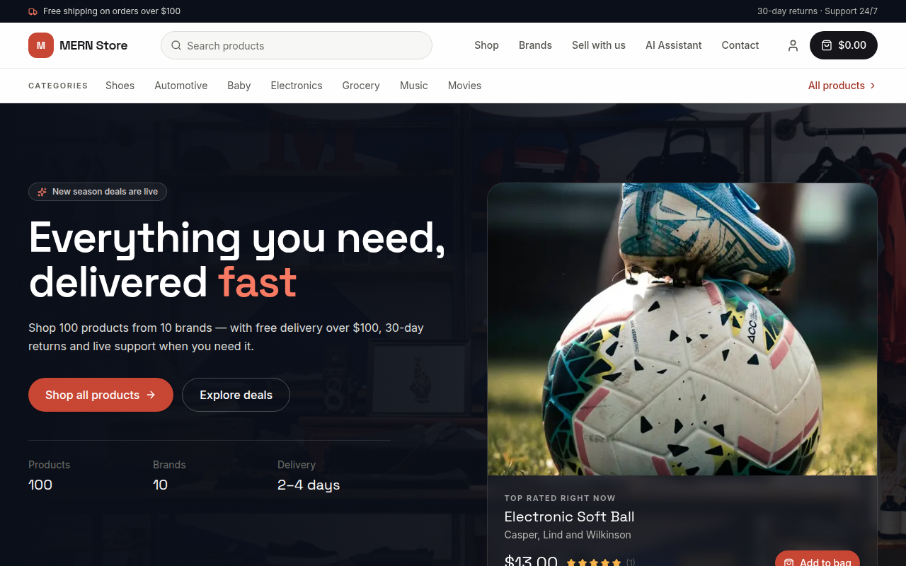
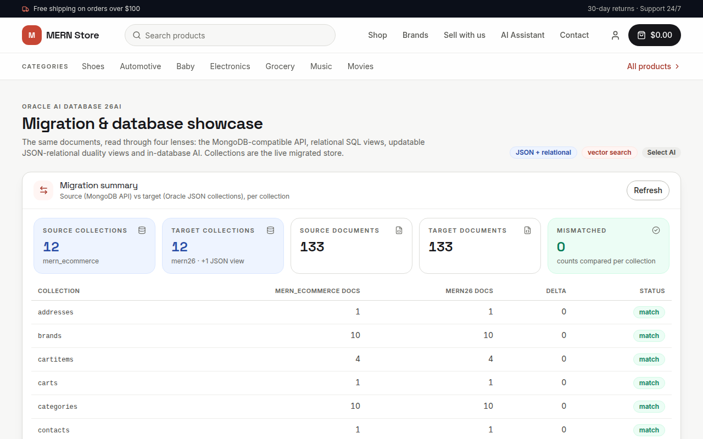
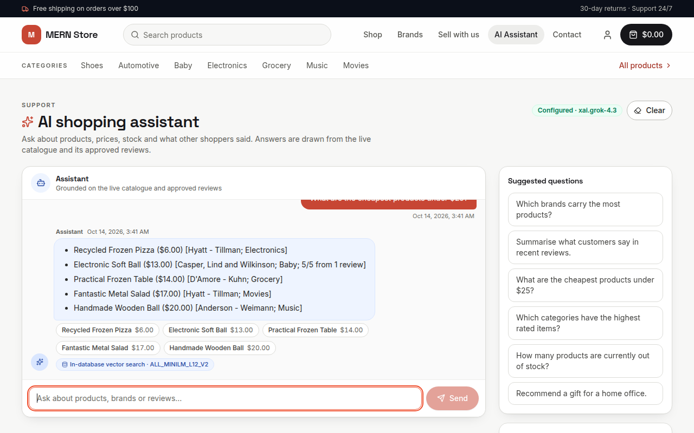

# Introduction

## About this Workshop

Moving a MongoDB application to another database usually means rewriting its data layer. In this workshop you do not. You take a working MERN storefront (React, Express, Mongoose) and move its data to Autonomous AI Database 26ai through the Oracle Database API for MongoDB, a MongoDB-compatible endpoint that lets MongoDB drivers and tools talk to Oracle Database. The application keeps its MongoDB driver, its Mongoose models and its routes. Only the connection string changes, plus four query patterns that behave differently on the Oracle API.

### The migration at a glance

You follow the same path a real migration takes:

1. **Source:** run the storefront on a local MongoDB (Lab 3).
2. **Assess:** measure what the workload does before you move it (Lab 4).
3. **Prepare:** create the target schemas in Autonomous AI Database (Lab 5).
4. **Migrate:** copy the data with `mongodump` and `mongorestore` (Lab 6).
5. **Validate and cut over:** compare source and target, then point the app at Oracle (Lab 7).
6. **Extend:** query the same data with SQL through relational views, and optionally add duality and validity views, vector search and Select AI (Labs 8 to 10).

> **Note:** This is an **offline** migration. `mongodump` takes a point-in-time copy, so any write made to the source after the dump is not carried over. In a production cutover you stop writes to MongoDB before the dump and restart the app against Oracle afterwards. In the labs you avoid storefront activity while you validate, then stop the API and restart it against Oracle (Lab 7).

### What changes in the app

The four patterns below behave differently on the Oracle API. The storefront already handles each one. Lab 4 profiles the workload, flags the constructs that need attention, such as `$lookup` and `$regex` with `$options`, and shows the code before and after each change.

| Pattern | What the Oracle API does | What the app does |
| --- | --- | --- |
| `$lookup` | No `let`; errors for some `localField` shapes | The product list uses one `$sql` stage on Oracle |
| `$elemMatch` in an update filter | Rejected | Order-line updates address the array element by index |
| `$regex` with a separate `$options` | `$options` is ignored | The flags live on the RegExp: `new RegExp(term, 'i')` |
| Numeric limits | `skip` must fit in int32; `NUMBER` tops out near 1e126 | The API clamps paging and numeric filters |

The MongoDB profiler command is also unavailable on Oracle, so you profile the workload on the source and use SQL Monitor on the target.

### Architecture

The React client talks to the Express API over HTTP and socket.io. The API uses Mongoose, which speaks the MongoDB wire protocol. On the source side, a MongoDB container on your workstation answers that protocol. On the target side, the Oracle Database API for MongoDB answers it, served by Oracle REST Data Services (ORDS, the web layer of Autonomous AI Database). The same data is also readable with plain SQL through relational views. Optional extras are JSON-relational duality views (read and write the same rows as relational tables or as JSON documents), validity views, a vector store and Select AI (natural-language questions turned into SQL).

You use three database accounts: `ADMIN` (creates schemas and grants), `MERN26` (JSON collections and SQL views) and `MERN26DV` (used only by the optional duality views in Lab 8).

Estimated Workshop Time: 4 hours 15 minutes (3 hours for Labs 1 to 8, 1 hour 5 minutes for the optional Labs 9 and 10, and 10 minutes for Clean Up)

### Objectives

By the end of this workshop you will have a MERN storefront running on Autonomous AI Database 26ai, with the same data queryable through MongoDB commands and through SQL. You will:

* Prepare a Linux, macOS or Windows workstation with the required tools (Lab 1)
* Provision an Autonomous AI Database 26ai, or locate the one in your reservation (Lab 2)
* Run the storefront on a local MongoDB (Lab 3)
* Assess the MongoDB workload before moving it (Lab 4)
* Create and prepare the `MERN26` and `MERN26DV` schemas (Lab 5)
* Migrate the data with `mongodump` and `mongorestore` through the MongoDB API (Lab 6)
* Validate the migration and cut the app over to Oracle (Lab 7)
* Query the migrated data with SQL through relational views (Lab 8), with optional duality and validity views
* Optional: add vector search and the AI assistant (Lab 9)
* Optional: ask questions in natural language with Select AI (Lab 10)

### Prerequisites

This workshop assumes you have:

* An Oracle Cloud tenancy where you can create an Autonomous AI Database, or a LiveLabs reservation that includes one
* A Linux, macOS or Windows 10/11 laptop where you have administrator rights
* Basic familiarity with a command line and with MongoDB or SQL

## Learn More

* [Oracle Database API for MongoDB](https://docs.oracle.com/en/database/oracle/mongodb-api/)
* [Autonomous AI Database documentation](https://docs.oracle.com/en/cloud/paas/autonomous-database/)
* [Source repository](https://github.com/jasperan/mongodb-migrate-oci)

## Acknowledgements

* **Author** - Ignacio Martinez, Oracle
* **Last Updated By/Date** - Ignacio Martinez, October 2026
* **Source** - The sample storefront is adapted from [mern-ecommerce](https://github.com/mohamedsamara/mern-ecommerce) by Mohamed Samara (MIT license)
