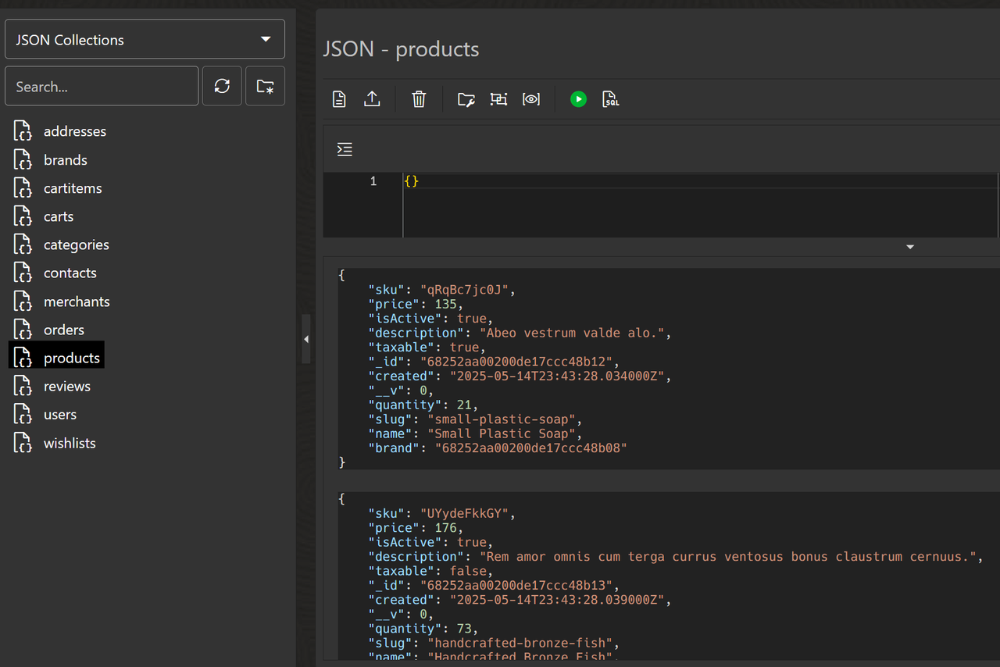

# Migrate the Data

## Introduction

This is the execute step. You dump the MongoDB source with `mongodump` and restore it into the `MERN26` schema of Autonomous AI Database with `mongorestore`, through the Oracle Database API for MongoDB. No custom migration code is involved: these are the standard MongoDB tools.

The workshop script `migrate-data` runs both tools in the right order with the right arguments, because one of those arguments is easy to get wrong without any error message.

Estimated Time: 15 minutes

### Objectives

In this lab, you will:

* Build the MongoDB API connection string (`TARGET_URI`) for the `MERN26` schema
* Dump the source and restore it into Oracle with the workshop script
* Understand why the dump directory must match the target URI
* Grant the restored collections to `MERN26DV` and verify the data with `mongosh`

### Prerequisites

This lab assumes you have:

* Completed **Lab 5: Prepare the Target Schemas** (the `MERN26` and `MERN26DV` schemas exist and are ORDS-enabled)
* `MONGO_API_HOST` from Lab 2 (the host name in the MongoDB API URL on the database's **Tool configuration** tab)
* MongoDB Database Tools (`mongodump`, `mongorestore`) and `mongosh` installed
* The source MongoDB container from Lab 3 still running
* A terminal open at the **root of the cloned repository**, with `ORACLE_CONNECT_STRING`, `MONGO_API_HOST`, `DB_PASSWORD` (the `ADMIN` password) and the Lab 5 variables set. If you opened a new terminal, set them again as in Lab 5

## Task 1: Build the target URI

The restore URI is the MongoDB API URL for the **target schema**: it signs in as `MERN26`, names the database `mern26`, and carries the options the API requires (`loadBalanced=true`, `authMechanism=PLAIN`, TLS). The `$external` in `authSource` must be written as `%24external` so that no shell expands it.

1. Build `TARGET_URI` from `MONGO_API_HOST` (Lab 2) and `MERN26_PASSWORD` (Lab 5). Nothing needs replacing. A password that uses only letters, digits and underscores (as recommended in Lab 5) needs no URL-encoding; if yours contains other characters, encode them (for example `#` becomes `%23`).

    <if type="linux">

    ```bash
    <copy>
    export TARGET_URI="mongodb://MERN26:${MERN26_PASSWORD}@${MONGO_API_HOST}:27017/mern26?loadBalanced=true&retryWrites=false&authMechanism=PLAIN&authSource=%24external&tls=true"
    </copy>
    ```

    </if>

    <if type="windows">

    ```powershell
    <copy>
    $env:TARGET_URI = "mongodb://MERN26:$($env:MERN26_PASSWORD)@$($env:MONGO_API_HOST):27017/mern26?loadBalanced=true&retryWrites=false&authMechanism=PLAIN&authSource=%24external&tls=true"
    </copy>
    ```

    </if>

2. Test the connection. The command lists the collections of `mern26`, which is empty before the restore.

    <if type="linux">

    ```bash
    <copy>
    mongosh "$TARGET_URI" --quiet --eval "db.getCollectionNames()"
    </copy>
    ```

    </if>

    <if type="windows">

    ```powershell
    <copy>
    mongosh $env:TARGET_URI --quiet --eval "db.getCollectionNames()"
    </copy>
    ```

    </if>

    The output is `[]`. If you get an authentication or connection error, check that your IP address is in the database access control list (Lab 2), that the `MERN26` password is the one you used in Lab 5, and that mutual TLS is not required.

## Task 2: Dump and restore

The script reads three settings. Only `TARGET_URI` is required.

| Setting | Default | Meaning |
| --- | --- | --- |
| `SOURCE_URI` | `mongodb://127.0.0.1:27017/mern_ecommerce` | The source MongoDB, including the database name |
| `TARGET_URI` | none | The Oracle MongoDB API URI naming `mern26` |
| `DUMP_DIR` | `./dump` | Where `mongodump` writes the dump |

1. Run the migration.

    <if type="linux">

    ```bash
    <copy>
    bash scripts/workshop/migrate-data.sh
    </copy>
    ```

    </if>

    <if type="windows">

    ```powershell
    <copy>
    .\scripts\workshop\migrate-data.ps1
    </copy>
    ```

    </if>

    The script runs `mongodump` against the source and then `mongorestore --drop --writeConcern '{w:1}'` against `TARGET_URI`, reading from `<DUMP_DIR>/<source database>` (here `dump/mern_ecommerce`). It never prints the password and exits with a non-zero code if zero documents were restored.

2. Read the end of the output. `mongorestore` reports the totals:

    ```
    N document(s) restored successfully. 0 document(s) failed to restore.
    ```

    `N` must equal the `TOTAL` you noted in Lab 4, and the failed count must be `0`.

## Task 3: Understand the dump directory pitfall

1. The restore step takes a directory argument, and the right value **depends on the URI**:

    * A URI that **names a database** (this one ends in `/mern26`) makes `mongorestore` use the "database directory" layout. The argument must be the **database directory**, `dump/mern_ecommerce`. The target database name comes from the URI.
    * A URI **without** a database name wants the dump **root**, `dump`.

2. Getting this wrong fails silently: with the dump root and this URI, `mongorestore` prints `don't know what to do with subdirectory "...mern_ecommerce", skipping...`, restores **0 documents** and still exits with code `0`. Adding `--nsFrom` and `--nsTo` on top of a URI that names a database changes nothing. That is why the workshop script derives the directory from the source database name and fails when nothing was restored. If you run the two tools by hand later, remember this rule and also make sure the dump is fresh.

3. The restore uses `--drop`, which replaces the collection tables in `MERN26`. Anything built on top of them (grants, views) must be rebuilt after a repeated restore. You rebuild the first part, the grants, now.

## Task 4: Grant the collections to MERN26DV

The restore just created the collections. Now `MERN26DV` needs access to them to host duality views later. `03_grants_after_restore.sql` grants `select`, `insert`, `update` and `delete` on every `MERN26` collection table to `MERN26DV`.

1. Run the grants script as `ADMIN`.

    <if type="linux">

    ```bash
    <copy>
    bash scripts/workshop/run-sql.sh ADMIN sql/26ai/03_grants_after_restore.sql
    </copy>
    ```

    </if>

    <if type="windows">

    ```powershell
    <copy>
    .\scripts\workshop\run-sql.ps1 -User ADMIN -File sql/26ai/03_grants_after_restore.sql
    </copy>
    ```

    </if>

2. The script prints `<n> collections granted to MERN26DV`, counting every JSON collection table in the `MERN26` schema (`12 collections granted to MERN26DV` for the seeded storefront), and then lists the grants (4 privileges per collection, 48 rows). Skipping this step is the loudest failure later: `MERN26DV` answers `ORA-00942: table or view "MERN26"."users" does not exist`.

## Task 5: Verify the data in Oracle

1. Count the documents of every collection through the MongoDB API.

    <if type="linux">

    ```bash
    <copy>
    mongosh "$TARGET_URI" --quiet --eval "db.getCollectionNames().forEach(c => print(c, db.getCollection(c).countDocuments({})))"
    </copy>
    ```

    </if>

    <if type="windows">

    ```powershell
    <copy>
    mongosh $env:TARGET_URI --quiet --eval "db.getCollectionNames().forEach(c => print(c, db.getCollection(c).countDocuments({})))"
    </copy>
    ```

    </if>

    The collection names (`addresses`, `brands`, `cartitems`, `carts`, `categories`, `contacts`, `merchants`, `orders`, `products`, `reviews`, `users`, `wishlists`) and counts match the source collections table from Lab 4.

2. Optionally, look at the same collections in the database: open **Database actions > JSON** for the `MERN26` user, or sign in to Database Actions as `MERN26`. Each MongoDB collection is a JSON collection in the schema.

    

    > **Note:** The screenshot is from an earlier migration of the same application; your product documents differ.

You may now **proceed to the next lab**.

## Learn More

* [Quick Start Guide for MongoDB Migrations](https://docs.oracle.com/en/database/oracle/mdbqs/index.html)
* [mongorestore documentation](https://www.mongodb.com/docs/database-tools/mongorestore/)
* [Oracle Database API for MongoDB](https://docs.oracle.com/en/database/oracle/mongodb-api/index.html)

## Acknowledgements

* **Author** - Ignacio Martinez, Oracle
* **Last Updated By/Date** - Ignacio Martinez, October 2026
