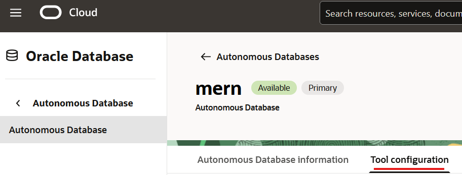
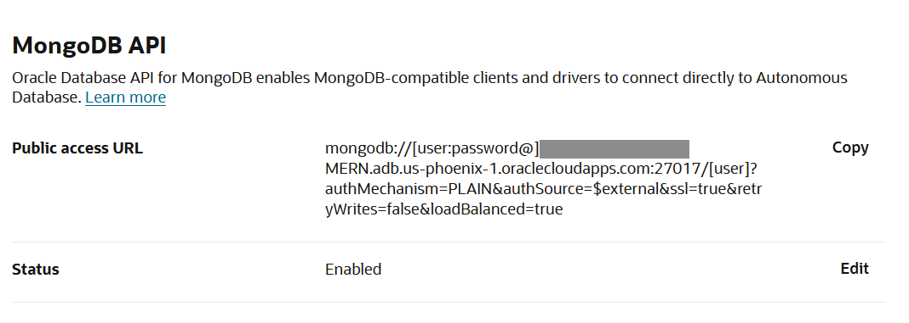

# Provision Autonomous AI Database 26ai

## Introduction

The migration target is an Autonomous AI Database 26ai (Transaction Processing workload). Your reservation already created it, but the Oracle Database API for MongoDB needs two things from it: it must accept TLS connections from your workstation's IP address, and it must not require a client wallet (mutual TLS, or mTLS, would). In this lab you open the database to your workstation, enable the MongoDB API, collect the two connection strings the later labs need and save them in environment variables.

Estimated Time: 20 minutes

### Objectives

In this lab, you will:

* Locate your reservation's Autonomous AI Database
* Allow your public IP address and set mutual TLS (mTLS) to not required
* Copy the TLS connect string and the MongoDB API URL
* Store the connect string and the MongoDB API host name as environment variables

### Prerequisites

This lab assumes you have:

* A started LiveLabs reservation
* Completed Lab 1

## Task 1: Get the database

Open your reservation's database and allow connections from your workstation.

1. In your LiveLabs reservation, click **View Login Info** and open the Autonomous AI Database link.

2. Copy the `ADMIN` password from the login info and keep it. later labs need it.

3. On the database details page, click **Network**.

4. If your public IP address is not in the access control list (the list of addresses allowed to connect), click **Edit** and add it. To find your address, search "what is my IP" in a browser.

5. If **Require mutual TLS (mTLS) authentication** is enabled, set it to **not required**. mTLS needs a client wallet (a download that holds the client certificates); the MongoDB API uses plain TLS instead.

6. Save, then wait for the state to return to **Available**.

## Task 2: Copy the connection strings

Collect the two strings your tools use to reach the database: a TLS connect string for SQLcl and the MongoDB API URL for `mongodump` and `mongorestore`.

1. On the database details page, click **Database connection** and set **TLS authentication** to **TLS**.

2. Copy the **High** (or Low) connection string of type TLS. This is the long connect string that works without a wallet.

3. Open the **Tool configuration** tab and find **MongoDB API**. The Oracle Database API for MongoDB is **not enabled by default**: if its status is not enabled, enable it and wait for the database to return to **Available**.

4. Copy the **public access URL**.

    

    

    The URL has this shape: `mongodb://[user:password@]<adb-host>:27017/[user]?authMechanism=PLAIN&authSource=$external&ssl=true&retryWrites=false&loadBalanced=true`.

## Task 3: Set environment variables

Save the two values so later labs can reuse them without pasting them again.

1. Replace the placeholders and run the block for your shell.

    * `ORACLE_CONNECT_STRING` is the TLS connect string from Task 2.
    * `MONGO_API_HOST` is only the host name from the MongoDB API URL: the part between `@` or `//` and `:27017`, for example `abc123-mydb.adb.us-phoenix-1.oraclecloudapps.com`. Leave out the user name, password and port.

    <if type="linux">

    ```bash
    <copy>
    export ORACLE_CONNECT_STRING='<TLS connect string from Task 2>'
    export MONGO_API_HOST='<adb-host from the MongoDB API URL>'
    </copy>
    ```

    </if>

    <if type="windows">

    ```powershell
    <copy>
    $env:ORACLE_CONNECT_STRING = '<TLS connect string from Task 2>'
    $env:MONGO_API_HOST = '<adb-host from the MongoDB API URL>'
    </copy>
    ```

    </if>

    Variables last only as long as the terminal. Later labs build the MongoDB connection string from `MONGO_API_HOST`, so use the same terminal, or run this block again in a new one. The `MERN26` password does not exist yet: you choose it in Lab 5, and Lab 6 builds the full connection string.

You now have an Autonomous AI Database that accepts TLS connections from your workstation, the MongoDB API enabled, and both connection values saved.

You may now **proceed to the next lab**.

## Learn More

* [Autonomous AI Database documentation](https://docs.oracle.com/en/cloud/paas/autonomous-database/)
* [Oracle Database API for MongoDB](https://docs.oracle.com/en/database/oracle/mongodb-api/)

## Acknowledgements

* **Author** - Ignacio Martinez, Oracle
* **Last Updated By/Date** - Ignacio Martinez, October 2026
