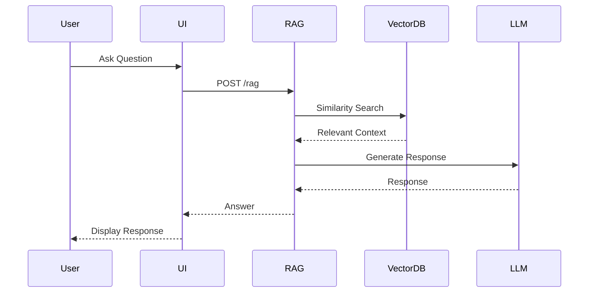
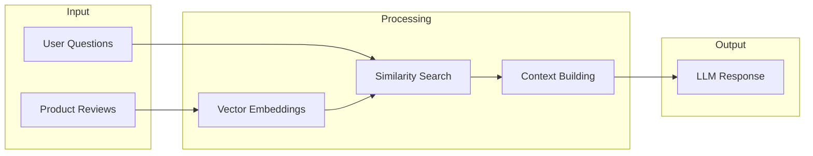
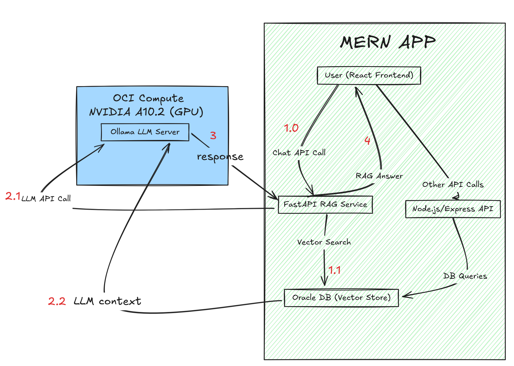

# AI and Analytics Enhancement Solution

## Introduction

This solution demonstrates how to enhance a migrated MERN (MongoDB, Express, React, Node.js) ecommerce application with AI and analytics capabilities on Oracle Autonomous Database.

The application has the following features:
- **M**ongoose schemas for data modeling
- **E**xpress middleware for request handling
- **R**eact frontend components
- **N**ode.js backend environment

Building on the foundation of the [Simple Migration](../simple-migration/README.md) and [Complex Migration](../complex-migration/README.md) solutions—which guide you through migrating your MongoDB-based MERN app to Oracle Autonomous AI Database 26ai and creating JSON Duality Views — this solution adds advanced features such as:
- In-database vector search using Oracle AI Database 26ai's vector capabilities on native JSON collections
- Retrieval-Augmented Generation (RAG) with a Large Language Model (LLM) via the `ollama` API
- Seamless integration of LLM-powered chat and analytics into your MERN app, accessible through the familiar React frontend
- **Database-focused approach**: Uses the existing `reviews` JSON collection via SODA (Simple Oracle Document Access) instead of creating separate relational tables

The architecture enables you to:
- Migrate your data and application logic from MongoDB to Oracle with minimal changes
- Leverage Oracle's vector search and LLM integration for intelligent chat, recommendations, and analytics
- Expose these AI features through your existing MERN stack, making them easily accessible to end users

## Overview

The solution mainly showcases:

- Vector processing and semantic search
- AI chat with the LLM through a Retrieval-Augmented Generation (RAG) pipeline
- AI-enhanced application features: chat with the product reviews from the app
- **Distributed RAG** inference for scalability via OpenAPI REST calls

Visually, the final functionality of the application will be something like this:

### [RAG Pipeline Flow](./img/rag_pipeline_flow.png)



### [Data Flow](./img/data_flow.png)



## 0. Prerequisites & Docs

### Prerequisites

- Oracle AI Database 26ai instance
- **Completed [Simple Migration](../simple-migration/README.md)**: Successfully migrated MongoDB collections to Oracle using `mongorestore`
- **Completed [Complex Migration](../complex-migration/README.md)**: Successfully created JSON Duality Views using the normalized script and imported data into the `ecommercedv` schema
- Python 3.10+ to expose the LLM through FastAPI
- Node.js 18+ and `npm` for the MERN application
- Access to a GPU infrastructure compute to install `ollama` and deploy the LLM for inference

### Required Setup

We will need to install `ollama` in a server that has a GPU (a prerequisite for most Large Language Models): 

   ```bash
   # Linux
   curl -fsSL https://ollama.com/install.sh | sh
   
   # Windows
   winget install ollama
   ```

And create a `config.yaml` file to hold our sensitive config parameters:

   ```yaml
   ORACLE_DB_USERNAME: "your_db_username"
   ORACLE_DB_PASSWORD: "your_db_password"
   ORACLE_DB_DSN: (description= (retry_count=20)(retry_delay=3)....(host=adb.us-phoenix-1.oraclecloud.com))(connect_data=(service_name=....))(security=(ssl_server_dn_match=yes)))

   ollama:
     endpoint: http://localhost:11434
   ```

Finally, let's spin up our `ollama` server so we can deploy an LLM:

```bash
# Start Ollama
ollama serve
# then, download phi3 or whichever model you want to use.
ollama pull phi3 

# Start RAG API endpoint, which will be called by the express API
uvicorn rag_api:app --host 0.0.0.0 --port 8000 --reload

# Now, our extra endpoint is running and we can start making requests to it just by spinning up the app.
# Start MERN app
# go to the root directory
cd mongodb-migrate-oci/mern-ecommerce
npm install
npm run dev
```

### Docs

- [`ollama` through API](https://www.gpu-mart.com/blog/ollama-api-usage-examples)
- [Upgrade ollama](https://github.com/ollama/ollama/blob/main/docs/faq.md#how-can-i-upgrade-ollama)
-[Building a Multi-Agent AI Application on Oracle Cloud Infrastructure](https://blogs.oracle.com/developers/post/agentic-rag-enterprisescale-multiagent-ai-system-on-oracle-cloud-infrastructure)
-[Setting an AI Profile on a Database Connection](https://docs.oracle.com/en/database/oracle/developer-tools-for-vscode/getting-started/setting-ai-profile-database-connection.html)
- [MongoDB Shell](https://www.mongodb.com/try/download/shell)
- [Connect to a MongoDB Instance](https://www.mongodb.com/docs/database-tools/mongodump/#connect-to-a-mongodb-instance)

## LLM Chat Feature Implementation

We're going to expand the original functionality of the app to include an AI chat feature. This will allow us to chat with whatever data is on the database. 

It's not going to be a standard AI chat, as that wouldn't add any value to us: if we wanted to speak with a Large Language Model, we have several possibilities to do so, we don't need the MERN app.

So, why implement it into the MERN ecommerce application? This will allow us to:
- Have customized responses from the AI model, by creating a Retrieval-Augmented Generations (RAG) system
- We will interact with the ecommerce application's data and be able to ask questions about it

How can we set up an AI chat that will help us do that without interfering with the original functionality of the app? Well, we're going to implement this using the MERN architecture:
- We need to create a new API endpoint that will allow the app to communicate with the LLM with Express
- Set up a quick Node.js and React front-end (a chat interface that will make an API request to the LLM every time the user presses the `send` button) 
- Set up the compute infrastructure that will host the LLM, more specifically, with the `ollama` framework
- The Mongo component has already been achieved since we already performed the migration between MongoDB and Oracle Autonomous JSON Database, through the MongoDB API tool.

Here is a simple architecture that details the numbered steps performed in the back-end:



- The backend will call the Ollama API for chat completions using the context retrieved from your Oracle SODA collections (specifically the `reviews` collection).

The distributed RAG implementation is achieved through several key components working together:

1. Vector Store `(oracle_vector_store.py)`
2. LLM Client `(ollama_client.py)`
3. RAG API `(rag_api.py)`
4. Testing `(test_rag.py)`

Let's go into detail for each one of these components:

### 1. Vector Store Setup

To perform vector similarity search, we need to add embeddings to the existing `reviews` JSON collection using SODA (Simple Oracle Document Access). This collection was created during the migration process and contains all the review documents.

Thanks to Oracle Autonomous database and SODA, we can perform NoSQL-style operations on JSON documents while leveraging vector capabilities for similarity search. The system uses Euclidean distance for vector similarity calculations, which is the backbone of any RAG system.

It's important to note that, in order to successfully enable RAG as a pipeline, we need to consider that all the incoming reviews for our MERN application will **not automatically** have embeddings, as this is an external additional feature we're providing to the app. Therefore, we need to set up some kind of automation system that will take all the current reviews from the MERN app's review collection, and add embeddings to them. Additionally, we will use this opportunity to also **create the embeddings** to the JSON documents, so the vector distance between reviews can be computed!

Therefore, this file called [`review_collection_sync`](./review_collection_sync.py) does exactly this using SODA operations.

Run the script once (after you've performed your migration) - note that after getting new reviews you'll have to re-run this script to update the embeddings in the `reviews` collection:

```bash
python review_collection_sync.py --ingest # run with ingest mode
# this adds embeddings to existing reviews in SODA collection
```

Then, when we have the database backend created, we already have access to:
- Vector similarity search function 
- Reviews JSON collection with embeddings

Now, the LLM has everything it needs to talk with the RAG system!

#### Don't have enough reviews / want more?

If you don't have enough reviews to test this system as you're implementing, I have prepared [this Python script](./generate_reviews.py).

You can generate *100* randomized reviews for a product and insert them into the Oracle SODA collection.

For this, run the following script, and then proceed with the above content in section `Vector Store Setup`:

1. Fill in `config.yaml` with your Oracle DB and Ollama endpoint details.
2. Run the script:

   ```bash
   # Generate reviews and save to file (specify a product id from your database)
   python generate_reviews.py --generate --product-id <product_id> --file my_reviews.json
   # Insert generated reviews into Autonomous JSON collection
   python generate_reviews.py --insert --file my_reviews.json
   # Generate and insert in one step (uses default product id)
   # python generate_reviews.py --generate --insert
   ```

After these reviews have been imported into the SODA collection, they will already be in the embeddings format, so we can just query to check if the insertions were performed correctly:

```bash
python review_collection_sync.py --display
```

### 2. RAG API Implementation

Now that we have a RAG pipeline in place, we need to expose it / integrate it with the MERN architecture. How do we do that? There are lots of ways to achieve it, but the easiest way is to **run a REST microservice** that allows request from the MERN app from a specific Express endpoint, and retrieves the RAG context when needed. 

> **Note**: this microservice doesn't need to run on the same IP address as where the MERN app is running; but be mindful of which API Endpoint you're invoking. If you have the microservice running somewhere else, make sure to appropriately reference and call it in `client/app/utils/llmChatApi.js` (see below).

Therefore, we will:
   - Expose a FastAPI endpoint for RAG queries through `rag_api.py` that:
     - Accepts POST requests to `/rag` with a question parameter
     - Retrieves relevant context from Oracle vector store
     - Builds a prompt combining context and question
     - Generates response using Ollama LLM
     - Returns answer to the MERN frontend
   - Add this endpoint into the Express API list by:
     - Creating a new route in the MERN backend's Express server
     - Making HTTP requests to the FastAPI endpoint when chat messages are sent
     - Handling responses and errors appropriately
     - Updating the React frontend to display the AI responses in the chat interface

Run the script wherever you're planning to deploy the microservice:

```bash
uvicorn rag_api:app --host 0.0.0.0 --port 8000 --reload 
```

Below are code snippets showing how the MERN app communicates with the distributed RAG API and how the RAG API is implemented.

1. **Frontend**: Sending a Chat Message to the RAG API

   On the frontend, we updated the chat utility `(client/app/utils/llmChatApi.js)` so that chat messages are sent directly to this FastAPI endpoint, bypassing the Node.js/Express backend for LLM queries. No changes were required to the Express backend for this integration, as the frontend now communicates directly with the Python RAG service for all AI chat functionality:

   ```js
   // client/app/utils/llmChatApi.js
   import axios from 'axios';

   export async function sendLlmChatMessage(message) {
   // Directly call the FastAPI RAG endpoint
   // if your microservice is running somewhere else, use that IP address instead of localhost.
   const res = await axios.post('http://localhost:8000/rag', { question: message });
   return res.data;
   }
   ```

2. **Frontend**: Displaying the LLM Response

   The chat UI component `(LlmChat.js)` was also updated to display the LLM's response from the answer field in the returned JSON:

   ```jsx
   // client/app/components/Store/LlmChat/LlmChat.js
   const handleSend = async (e) => {
   e.preventDefault();
   if (!input.trim()) return;
   setMessages((msgs) => [...msgs, { from: 'user', text: input }]);
   setLoading(true);
   try {
      const res = await sendLlmChatMessage(input);
      setMessages((msgs) => [...msgs, { from: 'llm', text: res.answer }]);
   } catch (err) {
      setMessages((msgs) => [...msgs, { from: 'llm', text: 'Error: Could not get response.' }]);
   }
   setInput('');
   setLoading(false);
   };
   ```

3. FastAPI **RAG Endpoint**

   ```python
   # rag_api.py
   from fastapi import FastAPI
   from pydantic import BaseModel
   from fastapi.middleware.cors import CORSMiddleware
   import yaml
   from oracle_vector_store import OracleVectorStore
   from ollama_client import OllamaClient

   app = FastAPI()
   app.add_middleware(
      CORSMiddleware,
      allow_origins=["*"],
      allow_credentials=True,
      allow_methods=["*"],
      allow_headers=["*"],
   )

   class RAGRequest(BaseModel):
      question: str

   with open('config.yaml', 'r') as f:
      config = yaml.safe_load(f)

   vector_store = OracleVectorStore(config)
   ollama = OllamaClient(config['ollama']['endpoint'])

   def build_context(docs, max_tokens=1000):
      context = ""
      token_count = 0
      for d in docs:
         text = d.get('text') or ''
         tokens = len(text.split())
         if token_count + tokens > max_tokens:
               break
         context += text + "\n"
         token_count += tokens
      return context.strip()

   @app.post("/rag")
   async def rag_endpoint(req: RAGRequest):
      docs = vector_store.similarity_search(req.question, top_k=5)
      context = build_context(docs)
      prompt = f"You are an expert assistant. Use the following context to answer the question.\n\nContext:\n{context}\n\nQuestion: {req.question}\nAnswer:"
      answer = ollama.generate(prompt, model="phi3")
      return {"answer": answer}
   ```

These examples show how the MERN frontend sends a chat message to the distributed RAG API, which performs vector search and LLM inference, and returns the answer to be displayed in the chat UI.

### 3. Testing

For testing, I created two specific Python files that can be helpful for this purpose:

1. [`test_rag.py`](./test_rag.py) (RAG):
   - Provides a simple way to test the RAG pipeline
   - Demonstrates basic usage with vector similarity search and a user's query
   - Helps verify the integration works end-to-end - particularly interesting when testing the backend communication with the LLM

2. [`ollama_client.py`](./ollama_client.py) (no RAG): 
   - Provides a clean interface to interact with the Ollama API (with or without streaming enabled)
   - Handles streaming responses from the LLM
   - Manages API communication and error handling
   - Supports both streaming and non-streaming generation modes

Feel free to use these files to your convenience when setting up the system.

### Notes

The distributed nature of the LLM chat component comes from:
- Separating vector storage (Oracle) from LLM inference (Ollama), which has obvious performance and scalability advantages.
- Using REST APIs for communication between components, conforming to the MERN standard
- Allowing independent scaling of vector search and LLM inference
- Supporting multiple LLM instances and models through the Ollama feamework. By default, I enabled `phi3` as the standard model to use.


## Contributing

This project welcomes contributions from the community. Before submitting a pull
request, please [review our contribution guide](./CONTRIBUTING.md).

## Security

Please consult the [security guide](./SECURITY.md) for our responsible security
vulnerability disclosure process.

## License
Copyright (c) 2024 Oracle and/or its affiliates.

Licensed under the Universal Permissive License (UPL), Version 1.0.

See [LICENSE](LICENSE.txt) for more details.

ORACLE AND ITS AFFILIATES DO NOT PROVIDE ANY WARRANTY WHATSOEVER, EXPRESS OR IMPLIED, FOR ANY SOFTWARE, MATERIAL OR CONTENT OF ANY KIND CONTAINED OR PRODUCED WITHIN THIS REPOSITORY, AND IN PARTICULAR SPECIFICALLY DISCLAIM ANY AND ALL IMPLIED WARRANTIES OF TITLE, NON-INFRINGEMENT, MERCHANTABILITY, AND FITNESS FOR A PARTICULAR PURPOSE.  FURTHERMORE, ORACLE AND ITS AFFILIATES DO NOT REPRESENT THAT ANY CUSTOMARY SECURITY REVIEW HAS BEEN PERFORMED WITH RESPECT TO ANY SOFTWARE, MATERIAL OR CONTENT CONTAINED OR PRODUCED WITHIN THIS REPOSITORY. IN ADDITION, AND WITHOUT LIMITING THE FOREGOING, THIRD PARTIES MAY HAVE POSTED SOFTWARE, MATERIAL OR CONTENT TO THIS REPOSITORY WITHOUT ANY REVIEW. USE AT YOUR OWN RISK. 
