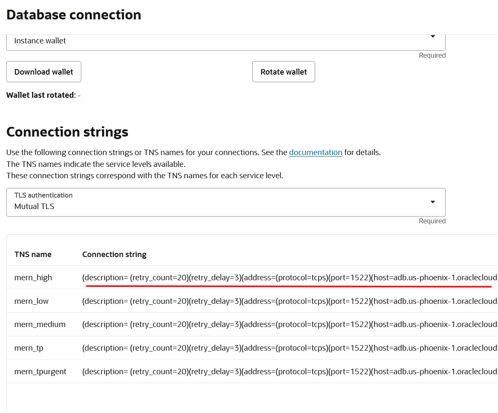
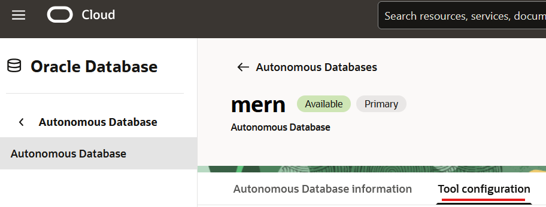
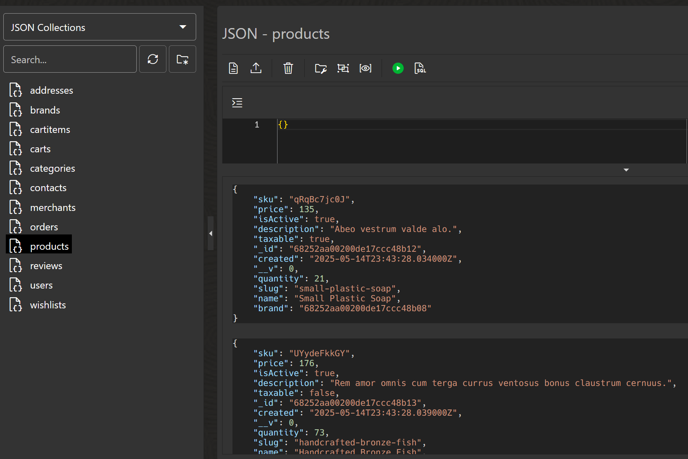

# Simple App Migration

## Introduction

This solution demonstrates a straightforward migration of a MERN (MongoDB, Express, React, Node.js) application to Oracle Database through the MongoDB API.

## Overview

The migration process involves:
1. Setting up the MERN ecommerce application
2. Exporting data from MongoDB using either:
   - `mongodump` and `dbms_migrator` (traditional approach)
   - Python-based direct migration utility (alternative approach)
3. Importing data into Oracle Autonomous Database with `mongorestore`
4. Verifying the migration
5. Using the MERN application, now connected to Autonomous
6. Creating a view to query this data

## Architecture

```bash
[User]
  |
[React Chat UI] <--> [Express API] <--> [Oracle 23ai Vector Search]
                                                    |
                                                [Ollama LLM API]
```
- All product, review, and user data is initially stored in a `mongodb` database, while we provide easy migration steps to transition to Oracle Autonomous JSON Database 23ai. This way, users will benefit from all 23ai features, including self maintenance and integrated in-database LLMs.
- Vector search is performed in-database with `vector_distance` and `text_embedding` functions.
- The LLM chat endpoint retrieves relevant context from Oracle, then calls the Ollama API for a response.

## Prerequisites
- `node.js` 18+ and `npm`
- A `mongodb` database running
- `mongodump` and `mongorestore` utilities installed where you're planning to run the migration from
- Oracle Autonomous JSON Database 23ai, with the MongoDB API plugin/tool enabled
- Python environment with Anaconda or `venv` to run provided scripts (which will automate most of the troubles)

## Local Development Setup

First, we will install the requirements needed to run the `MERN` application; but first, let's understand what we want to achieve and how:
1. Perform a migration from a containerized/local MongoDB database to Oracle Autonomous Database through MongoDB API
2. Enable MongoDB API tools and retrieve MongoDB API URI, which will be our tool to make this seamless change of functionality in the MERN application.
3. Change MongoDB URI string, so that the application will then run on Autonomous.
4. Verify that the app works the same

### 1. Backend Setup

Let's set up the MERN application first, running against our local/containerized MongoDB instance.

1. First, we'll install `npm` dependencies:

  ```bash
  cd mern-ecommerce/server
  npm install
  ```

  

2. Then, create a `.env` file in the `server/` directory with at least the following environment variables. Make sure to specify these ones as best you can, considering these notes:
  - `ORACLE_CONNECT_STRING` variables can be obtained from the Autonomous Database `Database Connections` tab
  - `OLLAMA_API_URL`: this will be used to communicate with an `ollama` inferencing server, so if you're planning to run the AI part of this solution, specify your ollama endpoint.
  - `MONGO_URI`: URI for your initial `mongodb` database, from where you want to perform the migration from.
  - `CLIENT_URL`: set to `http://localhost:8080` as constant.

  ```bash
  # example .env file you can edit
  ORACLE_USER=your_oracle_user
  ORACLE_PASSWORD=your_oracle_password
  ORACLE_CONNECT_STRING=your_oracle_connect_string
  JWT_SECRET=your_jwt_secret
  OLLAMA_API_URL=http://localhost:11434 # (or your Ollama endpoint), where the Large Language Model will be hosted
  MONGO_URI=mongodb://mongo:27017/mern_ecommerce # your local mongodb endpoint uri
  PORT=3000
  BASE_API_URL=api
  CLIENT_URL=http://localhost:8080
  ```

  > You can generate your own JWT_SECRET or invent your own using a random string. This will be used for authentication purposes within the MERN app.

3. Finally, once our MongoDB instance is running, we can seed it with a new admin user. The following command will add an administrator account which will let us login through the front-end:

  ```bash
  npm run seed:db admin@example.com admin123 && npm start
  # this creates an admin account so you can use it to manage the app.
  # format: email password
  ```

### 2. Frontend Setup

1. Similarly to the backend, we install `npm` dependencies:

  ```bash
  cd mern-ecommerce/client
  npm install
  # if you still get any type of error, run the following command additionally
  npm install npm-run-all --save-dev
  ```

2. Create a `.env` file in the `client/` directory with the following content:

  ```bash
  API_URL=http://localhost:3000/api
  ```

Now, we're ready to run the MERN app, with its backend running against MongoDB, which will be connected to the MongoDB API URI we specified in `./server/.env`.

### 3. Run the MERN app

After client & server setup on the MERN app, we're ready to run it! Run the following command to start a development environment (what we need):

  ```bash
  npm run dev
  ```

The frontend will be available at port 8080, [here](http://localhost:8080) by default (or as configured), and we'll be able to connect through a browser.

Make sure to test your app, explore its functionalities (like the product search function, adding addresses and merchants as admin, etc.)

> **Note**: it is recommended to try to use the application as much as possible, involving as many collections and features as possible, as this will populate your initial mongodb instance with all required data to successfully perform the migration. If later you have missing collections, you will need to amend the automatic migration process.

## 2. End-to-End Migration: MongoDB to Oracle Autonomous JSON DB

This section describes the recommended workflow to migrate your MERN app data from MongoDB to Oracle Autonomous JSON Database (with MongoDB API compatibility).

### 1. Export Data from MongoDB (mongodump)

From your MongoDB container or host, run:

```bash
mongodump --uri "mongodb://localhost:27017/mern_ecommerce?ssl=false&authSource=admin" -u <user> -p <password>
```

This will create a `dump/mern_ecommerce` directory with your data. Note that this MongoDB API URI corresponds to your own MongoDB host, not the Autonomous version.

### 2. Create Oracle DB Users/Schemas in Autonomous

Run the following SQL as an admin user (see [`sql/1.sql`](../../sql/1.sql)). This will create two new users: the first one will be used to perform the migration, and the other one will be used to create the JSON Duality Views of these collections, which will essentially allow us to have a relational schema compatible and updated with the JSON collections that were migrated:

```sql
-- as admin
GRANT DB_DEVELOPER_ROLE, DWROLE, UNLIMITED TABLESPACE, SODA_APP to ecommerce identified by "password";
GRANT DB_DEVELOPER_ROLE, DWROLE, UNLIMITED TABLESPACE, SODA_APP to ecommercedv identified by "password";

BEGIN
  ORDS.ENABLE_SCHEMA(
    p_enabled => TRUE,
    p_schema => 'ECOMMERCE',
    p_url_mapping_type => 'BASE_PATH',
    p_url_mapping_pattern => 'ecommerce',
    p_auto_rest_auth => FALSE
  );
END;
/

BEGIN
  ORDS.ENABLE_SCHEMA(
    p_enabled => TRUE,
    p_schema => 'ECOMMERCEDV',
    p_url_mapping_type => 'BASE_PATH',
    p_url_mapping_pattern => 'ecommercedv',
    p_auto_rest_auth => FALSE
  );
END;
/
```

> **Note**: the full script is [here.](../../sql/1.sql)

After the users and schemas have been created, grant select permissions from user `ecommercedv` to all the JSON native collections in the `ecommerce` user. Execute [`2.sql`](../../sql/2.sql):

```sql
-- run as admin
-- only execute after running mongorestore (collections need to have been created):
grant select on ecommerce.addresses to ecommercedv;
grant select on ecommerce.brands to ecommercedv;
grant select on ecommerce.cartitems to ecommercedv;
grant select on ecommerce.carts to ecommercedv;
grant select on ecommerce.categories to ecommercedv;
grant select on ecommerce.contacts to ecommercedv;
grant select on ecommerce.merchants to ecommercedv;
grant select on ecommerce.orders to ecommercedv;
grant select on ecommerce.products to ecommercedv;
grant select on ecommerce.reviews to ecommercedv;
grant select on ecommerce.users to ecommercedv;
grant select on ecommerce.wishlists to ecommercedv;
```

> **Note**: by granting only select, we will ensure that the user `ecommercedv` can read, but not modify the data from the `ecommerce` user.

### 3. Autonomous database setup

For this migration process to work with Autonomous, we'll need to enable the `MongoDB API` tool in our OCI panel:



Enable the MongoDB API tool/plugin within your Autonomous 23ai instance. Then, once enabled, you will be given a MongoDB URI, which will enable clients and drivers to connect [directly to Autonomous Database](https://docs.oracle.com/en-us/iaas/autonomous-database-serverless/doc/mongo-using-oracle-database-api-mongodb.html):


Copy this URI, remove the `[user@password]` part (we'll authenticate another way) and put it into your `server/.env` file, with the URI you extracted. Make sure to also change your `USER`, `PASSWORD` and `CONNECT_STRING` from the **Connections** tab.

```bash
# keep these additional parameters, only replacing the first part of the uri (mongodb://<oracle_host>:27017/ecommerce)
MONGO_URI=mongodb://<oracle_host>:27017/ecommerce?authMechanism=PLAIN&authSource=$external&ssl=true&retryWrites=false&loadBalanced=true 
ORACLE_USER=ecommerce # we will dump the data into the ecommerce user
ORACLE_PASSWORD=<oracle_password>
ORACLE_CONNECT_STRING=<oracle_connect_string>
```

### 4. Import Data to Oracle Autonomous (mongorestore)

Having checked that we already created users `ecommerce` and `ecommercedv` in step 2, it's time to import the data to the `ecommerce` user.

Use the MongoDB API endpoint for your Oracle Autonomous DB. Example (see [`dump_restore.sh`](../../dump_restore.sh)):

```sh
mongorestore -u ecommerce -p '<oracle_password>' --drop \
  --uri "mongodb://<oracle_host>:27017/ecommerce?loadBalanced=true&retryWrites=false&authMechanism=PLAIN&authSource=%24external&ssl=true" \
  --nsInclude=mern_ecommerce \
  --writeConcern '{w:0}' \
  --ssl \
  --tlsInsecure \
  ./dump/mern_ecommerce
```

> **Note**: the mongodb URI shall connect to user ecommerce (:27017/ecommerce) and the path must point to the directory mongodump previously generated for the migration (./dump/mern_ecommerce)

After finalizing the `mongorestore` operation, all JSON native collections present in the mongodb instance will have been successfully imported to the `ecommerce` schema!

When taking a look at the data present in Autonomous, all collections came with their respective data:



## 3. Data Visualizations for JSON native collections

Now that our JSON native collections have been imported, we can create some views in our Autonomous database.

**But, how?** Wouldn't you need to have a relational schema for that? Well, typically yes, but this is precisely one of the advantages of Autonomous Database: we can bridge the gap between noSQL and relational, combining the best of both architectures into one single database:
- In autonomous, we can store data as JSON
- This JSON data can be queried with either dot notation or SQL / JSON functions (very flexible)
- Relational or Duality Views can be set up on top of JSON native collections, to make them appear as if they were regular relational tables. (We will perform this step during the second demo: complex migration).

With this data, we'll then set up a couple of views using dot notation, to keep track of the inventory in our Autonomous database. I created two views:
- Track non-taxable products that can be purchased from the store
- Track all actively-sold products over 50$, to keep track of my more expensive products

```sql
-- this query was created to automatically monitor those products
-- that are over $50 and are active
-- run as admin 
CREATE OR REPLACE VIEW ECOMMERCE.active_products_over_50 AS
SELECT
  p.data.sku AS sku,
  p.data.price AS price,
  p.data.isActive AS is_active,
  p.data.description AS description,
  p.data.taxable AS taxable,
  p.data.created AS created,
  p.data."__v" AS version,
  p.data.quantity AS quantity,
  p.data.slug AS slug,
  p.data.name AS name,
  p.data.brand AS brand
FROM ECOMMERCE."products" p
WHERE p.data.price > 50;

-- also filter in taxable products
CREATE OR REPLACE VIEW ECOMMERCE.active_nontaxable_products AS
SELECT
  p.data.sku AS sku,
  p.data.price AS price,
  p.data.isActive AS is_active,
  p.data.description AS description,
  p.data.taxable AS taxable,
  p.data.created AS created,
  p.data."__v" AS version,
  p.data.quantity AS quantity,
  p.data.slug AS slug,
  p.data.name AS name,
  p.data.brand AS brand
FROM ECOMMERCE."products" p
  WHERE p.data.taxable = false;
```

> **Note**: get the full script [here.](../../sql/simple_migration_views.sql)

And now, we can set up a data stream to our Excel application to keep track of these products!


TODO


## 4. Start the MERN App with Oracle MongoDB API URI

Start the backend and frontend as usual:

  ```bash
  cd mern-ecommerce
  npm run dev
  ```

Now, the application will be running against your Autonomous 23ai instance, through the MongoDB API plugin we enabled! Your app is ready to use with all the simplest features of the app (all CRUD operations). Here are some of the operations that are officially supported by JSON native collections (which means, they will work after the simple app migration):
- Adding addresses
- Adding brands
- Adding items

For all other features that use **aggregation pipelines** (e.g. the product search page), we will need to perform a few more steps to transition from JSON native collections to accessing this data via JSON Duality Views. We will take a look at this process in the next solution called [complex app migration.](../complex-migration/README.md)

## Contributing

This project welcomes contributions from the community. Before submitting a pull
request, please [review our contribution guide](./CONTRIBUTING.md).

## Security

Please consult the [security guide](./SECURITY.md) for our responsible security
vulnerability disclosure process.

## License
Copyright (c) 2024 Oracle and/or its affiliates.

Licensed under the Universal Permissive License (UPL), Version 1.0.

See [LICENSE](LICENSE.txt) for more details.

ORACLE AND ITS AFFILIATES DO NOT PROVIDE ANY WARRANTY WHATSOEVER, EXPRESS OR IMPLIED, FOR ANY SOFTWARE, MATERIAL OR CONTENT OF ANY KIND CONTAINED OR PRODUCED WITHIN THIS REPOSITORY, AND IN PARTICULAR SPECIFICALLY DISCLAIM ANY AND ALL IMPLIED WARRANTIES OF TITLE, NON-INFRINGEMENT, MERCHANTABILITY, AND FITNESS FOR A PARTICULAR PURPOSE.  FURTHERMORE, ORACLE AND ITS AFFILIATES DO NOT REPRESENT THAT ANY CUSTOMARY SECURITY REVIEW HAS BEEN PERFORMED WITH RESPECT TO ANY SOFTWARE, MATERIAL OR CONTENT CONTAINED OR PRODUCED WITHIN THIS REPOSITORY. IN ADDITION, AND WITHOUT LIMITING THE FOREGOING, THIRD PARTIES MAY HAVE POSTED SOFTWARE, MATERIAL OR CONTENT TO THIS REPOSITORY WITHOUT ANY REVIEW. USE AT YOUR OWN RISK. 
